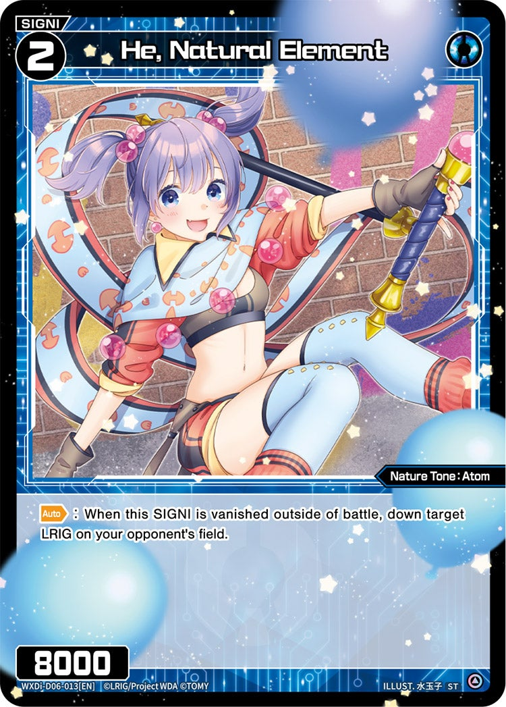

# He, Natural Element

## Thông tin lá

| Trường | Giá trị |
| --- | --- |
| Mã in | WXDi-D06-013[EN] |
| Set | WXDi-D06[EN] |
| Loại thẻ | SIGNI |
| Vị trí | Main Deck |
| Số bản D06 | 4 |
| Màu | Xanh dương |
| Độ hiếm | ST |
| Minh họa | 水玉子 |
| Level | 2 |
| Limit | — |
| Power | 8000 |
| LRIG type / Class | Nature Tone：Atom |
| Team / Master | — |
| Cost | — |
| Grow cost | — |
| Use timing | — |
| Life Burst | Không |

## Card text chính thức

[Auto]: When this SIGNI is vanished outside of battle, down target LRIG on your opponent's field.

## Power text / Life Burst

—

## Ghi chú minh họa
Artist: 水玉子. Ảnh ST được tải từ Card List tiếng Anh.

## FAQ chính thức

**Q. If this SIGNI is reduced to 0 or less power by some effect, it will be vanish by Rule-based action, but will [Auto] be activated?**
A. Yes, it will be triggered.

**Q. When this SIGNI is placed in the Ener zone by the Put target SIGNI~into Ener Zone. effect of Creation Tone etc, does [Auto] is triggered?**
A. No, it doesn't. The effect in the question is distinct from vanish.

## Nguồn
[Card List/FAQ chính thức](https://www.takaratomy.co.jp/products/en.wixoss/card/card.html?card_no=WXDi-D06-013%5BEN%5D ) · [Ảnh thẻ](https://www.takaratomy.co.jp/products/en.wixoss/card/thumb/WXDi-D06-013%5BEN%5D.jpg)
