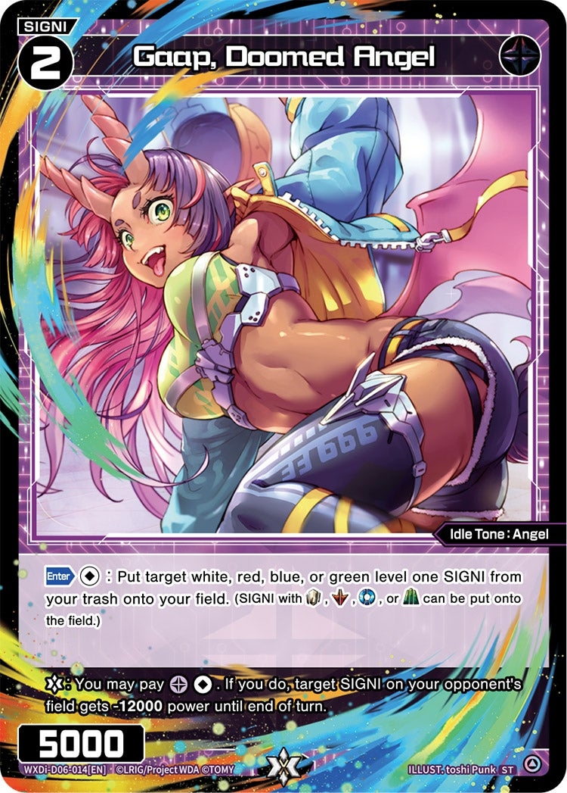

# Gaap, Doomed Angel

## Thông tin lá

| Trường | Giá trị |
| --- | --- |
| Mã in | WXDi-D06-014[EN] |
| Set | WXDi-D06[EN] |
| Loại thẻ | SIGNI |
| Vị trí | Main Deck |
| Số bản D06 | 4 |
| Màu | Đen |
| Độ hiếm | ST |
| Minh họa | toshi Punk |
| Level | 2 |
| Limit | — |
| Power | 5000 |
| LRIG type / Class | Idol Tone：Angel |
| Team / Master | — |
| Cost | — |
| Grow cost | — |
| Use timing | — |
| Life Burst | Có |

## Card text chính thức

[Enter] {Colorless}: Put target white, red, blue, or green level one SIGNI from your trash onto your field. (SIGNI with {white}, {red}, {blue}, or {green} can be put onto the field.)

## Power text / Life Burst

You may pay {Black} {Colorless}. If you do, target SIGNI on your opponent's field gets -12000 power until end of turn.

## Ghi chú minh họa
Artist: toshi Punk. Ảnh ST được tải từ Card List tiếng Anh.

## FAQ chính thức

**Q. Can I put a card I paid as Ener cost of [Enter] to my SIGNI zone by its effect?**
A. Yes, you can. Target is chosen after the cost payment.

**Q. Can I use [Enter] to put a SIGNI with multiple colors into play?**
A. Yes, you can.

## Nguồn
[Card List/FAQ chính thức](https://www.takaratomy.co.jp/products/en.wixoss/card/card.html?card_no=WXDi-D06-014%5BEN%5D ) · [Ảnh thẻ](https://www.takaratomy.co.jp/products/en.wixoss/card/thumb/WXDi-D06-014%5BEN%5D.jpg)
