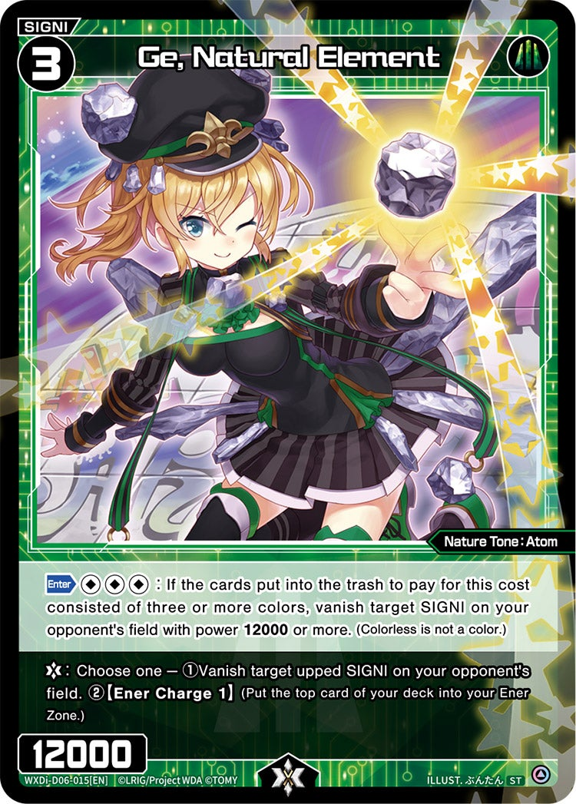

# Ge, Natural Element

## Thông tin lá

| Trường | Giá trị |
| --- | --- |
| Mã in | WXDi-D06-015[EN] |
| Set | WXDi-D06[EN] |
| Loại thẻ | SIGNI |
| Vị trí | Main Deck |
| Số bản D06 | 4 |
| Màu | Xanh lá |
| Độ hiếm | ST |
| Minh họa | ぶんたん |
| Level | 3 |
| Limit | — |
| Power | 12000 |
| LRIG type / Class | Nature Tone：Atom |
| Team / Master | — |
| Cost | — |
| Grow cost | — |
| Use timing | — |
| Life Burst | Có |

## Card text chính thức

[Enter] {Colorless} {Colorless} {Colorless}: If the cards put into the trash to pay for this cost consisted of three or more colors, vanish target SIGNI on your opponent's field with power 12000 or more. (Colorless is not a color.)

## Power text / Life Burst

Choose one — ①Vanish target upped SIGNI on your opponent's field. ②【Ener Charge 1】 (Put the top card of your deck into your Ener Zone.)

## Ghi chú minh họa
Artist: ぶんたん. Ảnh ST được tải từ Card List tiếng Anh.

## FAQ chính thức

**Q. If {Colorless} {Colorless} {Colorless} contains a Servant # with [Multi Ener], can I vanish the opponent SIGNI?**
A. This ability refers to the color of the card placed as a result of the payment, not the color of the Ener paid as a cost. Since 《Servant #》 is a colorless card, it doesn't count as a color type.

**Q. If I pay the [Enter] cost for a SIGNI that has multiple colors, can I count it as two different colors?**
A. Yes, you can count it. For example, 《Green Gas Type: Eins》 is green and black, so you can vanish your opponent's SIGNI if you have paid another type of other color.

## Nguồn
[Card List/FAQ chính thức](https://www.takaratomy.co.jp/products/en.wixoss/card/card.html?card_no=WXDi-D06-015%5BEN%5D ) · [Ảnh thẻ](https://www.takaratomy.co.jp/products/en.wixoss/card/thumb/WXDi-D06-015%5BEN%5D.jpg)
