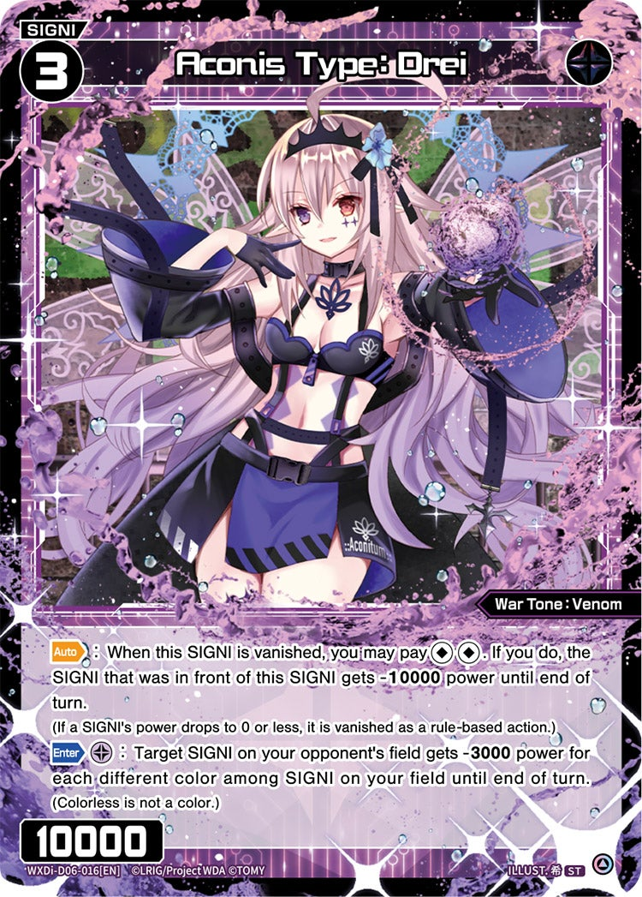

# Aconis Type: Drei

## Thông tin lá

| Trường | Giá trị |
| --- | --- |
| Mã in | WXDi-D06-016[EN] |
| Set | WXDi-D06[EN] |
| Loại thẻ | SIGNI |
| Vị trí | Main Deck |
| Số bản D06 | 4 |
| Màu | Đen |
| Độ hiếm | ST |
| Minh họa | 希 |
| Level | 3 |
| Limit | — |
| Power | 10000 |
| LRIG type / Class | War Tone：Venom |
| Team / Master | — |
| Cost | — |
| Grow cost | — |
| Use timing | — |
| Life Burst | Không |

## Card text chính thức

[Auto]: When this SIGNI is vanished, you may pay {Colorless} {Colorless}. If you do, the SIGNI that was in front of this SIGNI gets -10000 power until end of turn.
(If a SIGNI's power drops to 0 or less, it is vanished as a rule-based action.)
[Enter] {Black}: Target SIGNI on your opponent's field gets -3000 power for each different color among SIGNI on your field until end of turn. (Colorless is not a color.)

## Power text / Life Burst

—

## Ghi chú minh họa
Artist: 希. Ảnh ST được tải từ Card List tiếng Anh.

## FAQ chính thức

**Q. Can 《Servant #》 with [Multi Ener] be included when counting the number of color types SIGNI has with [Enter]?**
A. No, you cannot include it. [Multi Ener] is an ability that allows you to pay the Ener cost as one color of your choice, but it doesn't change the color of the card itself. 《Servant #》 itself is colorless, so it is not included in the color as the note says.

## Nguồn
[Card List/FAQ chính thức](https://www.takaratomy.co.jp/products/en.wixoss/card/card.html?card_no=WXDi-D06-016%5BEN%5D ) · [Ảnh thẻ](https://www.takaratomy.co.jp/products/en.wixoss/card/thumb/WXDi-D06-016%5BEN%5D.jpg)
