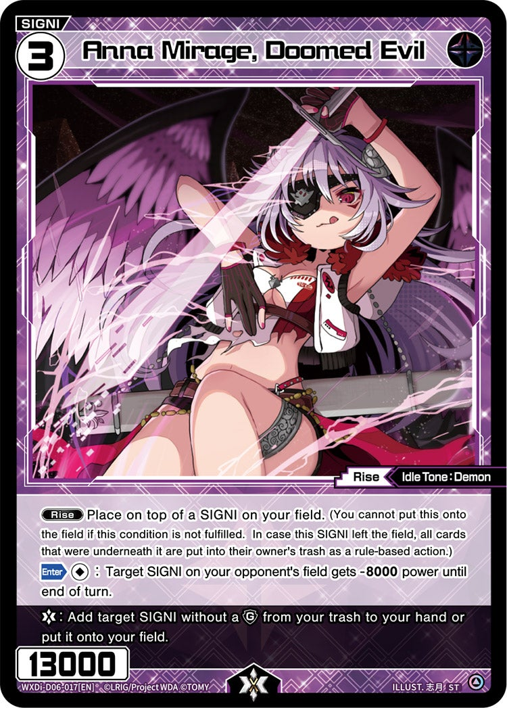

# Anna Mirage, Doomed Evil

## Thông tin lá

| Trường | Giá trị |
| --- | --- |
| Mã in | WXDi-D06-017[EN] |
| Set | WXDi-D06[EN] |
| Loại thẻ | SIGNI |
| Vị trí | Main Deck |
| Số bản D06 | 4 |
| Màu | Đen |
| Độ hiếm | ST |
| Minh họa | 志月 |
| Level | 3 |
| Limit | — |
| Power | 13000 |
| LRIG type / Class | Idol Tone：Demon |
| Team / Master | — |
| Cost | — |
| Grow cost | — |
| Use timing | — |
| Life Burst | Có |

## Card text chính thức

[Rise] Place on top of a SIGNI on your field. (You cannot put this onto the field if this condition is not fulfilled. In case this SIGNI left the field, all cards that were underneath it are put into their owner's trash as a rule-based action.)
[Enter] {Colorless}: Target SIGNI on your opponent's field gets -8000 power until end of turn.

## Power text / Life Burst

Add target SIGNI without a {Guard Icon} from your trash to your hand or put it onto your field.

## Ghi chú minh họa
Artist: 志月. Ảnh ST được tải từ Card List tiếng Anh.

## FAQ chính thức

— (không có FAQ riêng cho mã này trên trang FAQ tiếng Anh.)

## Nguồn
[Card List/FAQ chính thức](https://www.takaratomy.co.jp/products/en.wixoss/card/card.html?card_no=WXDi-D06-017%5BEN%5D ) · [Ảnh thẻ](https://www.takaratomy.co.jp/products/en.wixoss/card/thumb/WXDi-D06-017%5BEN%5D.jpg)
