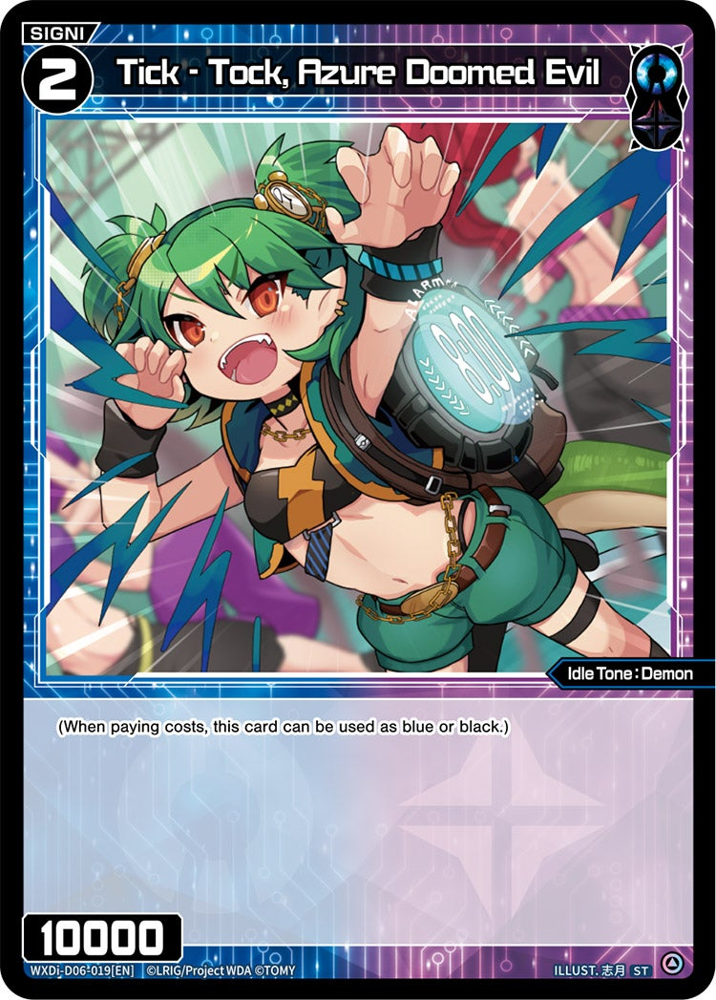

# Tick - Tock, Azure Doomed Evil

## Thông tin lá

| Trường | Giá trị |
| --- | --- |
| Mã in | WXDi-D06-019[EN] |
| Set | WXDi-D06[EN] |
| Loại thẻ | SIGNI |
| Vị trí | Main Deck |
| Số bản D06 | 4 |
| Màu | Xanh dương / đen |
| Độ hiếm | ST |
| Minh họa | 志月 |
| Level | 2 |
| Limit | — |
| Power | 10000 |
| LRIG type / Class | Idol Tone：Demon |
| Team / Master | — |
| Cost | — |
| Grow cost | — |
| Use timing | — |
| Life Burst | Không |

## Card text chính thức

(When paying costs, this card can be used as blue or black.)

## Power text / Life Burst

—

## Ghi chú minh họa
Artist: 志月. Ảnh ST được tải từ Card List tiếng Anh.

## FAQ chính thức

— (không có FAQ riêng cho mã này trên trang FAQ tiếng Anh.)

## Nguồn
[Card List/FAQ chính thức](https://www.takaratomy.co.jp/products/en.wixoss/card/card.html?card_no=WXDi-D06-019%5BEN%5D ) · [Ảnh thẻ](https://www.takaratomy.co.jp/products/en.wixoss/card/thumb/WXDi-D06-019%5BEN%5D.jpg)
