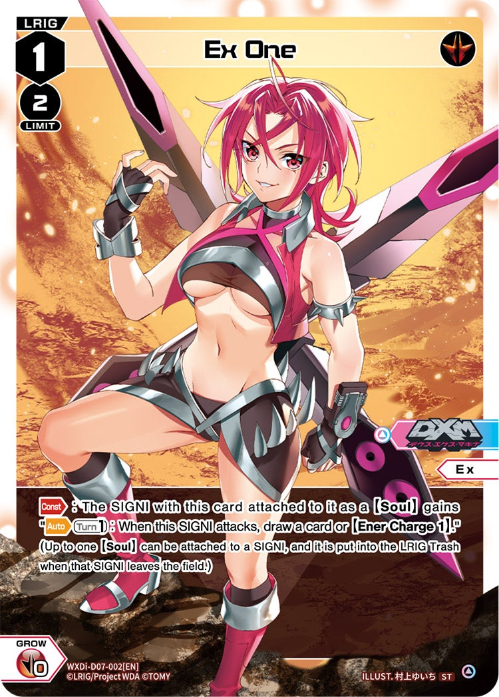

# Ex One

## Thông tin lá

| Trường | Giá trị |
| --- | --- |
| Mã in | WXDi-D07-002[EN] |
| Set | WXDi-D07[EN] |
| Loại thẻ | LRIG |
| Vị trí | LRIG Deck |
| Số bản D07 | 1 |
| Màu | Đỏ |
| Độ hiếm | ST,SCR |
| Minh họa | 村上ゆいち |
| Level | 1 |
| Limit | 2 |
| Power | 0 |
| LRIG type / Class | Ex |
| Team / Master | DEUS・EX・MACHINA |
| Cost | — |
| Grow cost | 《R》×０ |
| Use timing | — |
| Life Burst | Không |

## Card text chính thức

[Constant]: The SIGNI with this card attached to it as a 【Soul】 gains "[Auto] {1/Turn}: When this SIGNI attacks, draw a card or 【Ener Charge 1】."
(Up to one 【Soul】 can be attached to a SIGNI, and it is put into the LRIG Trash when that SIGNI leaves the field.)

## Power text / Life Burst

—

## Ghi chú minh họa
Artist: 村上ゆいち. Ảnh ST được tải từ Card List tiếng Anh.

## FAQ chính thức

**Q. What is 【Soul】?**
A. LRIG may be attached to SIGNI as 【Soul】 by effect. You cannot attach more than two 【Soul】 on a SIGNI. If the SIGNI with a 【Soul】 attached to it leaves the field, 【Soul】 will be put into its owner's LRIG trash by Rule-based action.

## Ảnh biến thể

- [SCR](../images/WXDi-D07-002S-EN.jpg)

## Nguồn
[Card List/FAQ chính thức](https://www.takaratomy.co.jp/products/en.wixoss/card/card.html?card_no=WXDi-D07-002%5BEN%5D ) · [Ảnh thẻ](https://www.takaratomy.co.jp/products/en.wixoss/card/thumb/WXDi-D07-002%5BEN%5D.jpg)
