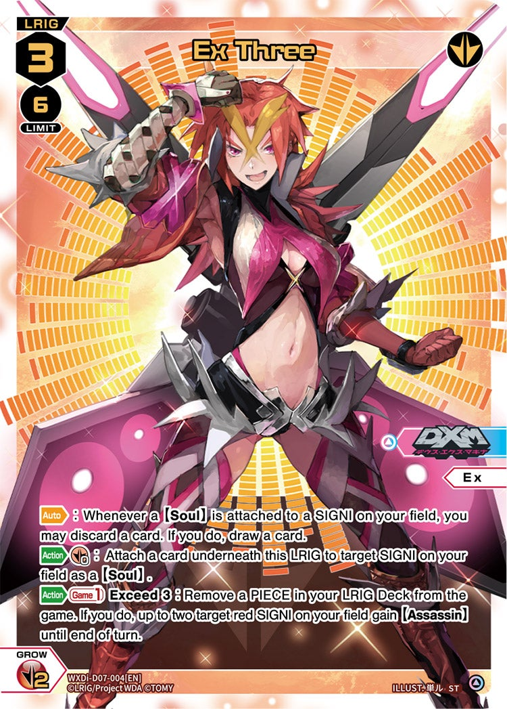

# Ex Three

## Thông tin lá

| Trường | Giá trị |
| --- | --- |
| Mã in | WXDi-D07-004[EN] |
| Set | WXDi-D07[EN] |
| Loại thẻ | LRIG |
| Vị trí | LRIG Deck |
| Số bản D07 | 1 |
| Màu | Đỏ |
| Độ hiếm | ST,SCR,DiR |
| Minh họa | 単ル |
| Level | 3 |
| Limit | 6 |
| Power | 0 |
| LRIG type / Class | Ex |
| Team / Master | DEUS・EX・MACHINA |
| Cost | — |
| Grow cost | 《R》×２ |
| Use timing | — |
| Life Burst | Không |

## Card text chính thức

[Auto]: Whenever a 【Soul】 is attached to a SIGNI on your field, you may discard a card. If you do, draw a card.
[Action] {Redx0}: Attach a card underneath this LRIG to target SIGNI on your field as a 【Soul】.
[Action] {1/Game} Exceed 3: Remove a PIECE in your LRIG Deck from the game. If you do, up to two target red SIGNI on your field gain 【Assassin】 until end of turn.

## Power text / Life Burst

—

## Ghi chú minh họa
Artist: 単ル. Ảnh ST được tải từ Card List tiếng Anh.

## FAQ chính thức

**Q. What is 【Soul】?**
A. LRIG may be attached to SIGNI as 【Soul】 by effect. You cannot attach more than two 【Soul】 on a SIGNI. If the SIGNI with a 【Soul】 attached to it leaves the field, 【Soul】 will be put into its owner's LRIG trash by Rule-based action.

**Q. What happens if I play [Action] ability and try to attach more 【Soul】 to the SIGNI that already has 【Soul】?**
A. Nothing happens because 【Soul】 cannot be attached to a SIGNI more than one. 【Soul】 that you tried to attach to the SIGNI does not move and remains in its original place. And in this case, this card's [Auto] ability does not trigger.

**Q. When I not have any card in my hand, this card was triggered [Auto] ability. May I draw a card?**
A. No, you cannot draw a card. If you cannot be discarded a card, the effect after "If you do" will not occur.

## Ảnh biến thể

- [SCR](../images/WXDi-D07-004S-EN.jpg)
- [DiR](../images/WXDi-D07-004D-EN.jpg)

## Nguồn
[Card List/FAQ chính thức](https://www.takaratomy.co.jp/products/en.wixoss/card/card.html?card_no=WXDi-D07-004%5BEN%5D ) · [Ảnh thẻ](https://www.takaratomy.co.jp/products/en.wixoss/card/thumb/WXDi-D07-004%5BEN%5D.jpg)
