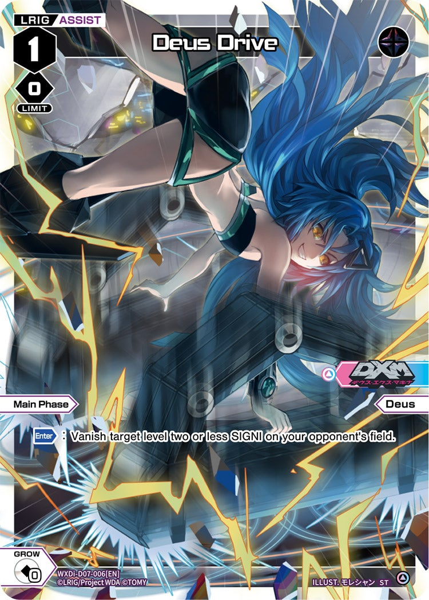

# Deus Drive

## Thông tin lá

| Trường | Giá trị |
| --- | --- |
| Mã in | WXDi-D07-006[EN] |
| Set | WXDi-D07[EN] |
| Loại thẻ | ASSIST LRIG |
| Vị trí | LRIG Deck |
| Số bản D07 | 1 |
| Màu | Đen |
| Độ hiếm | ST |
| Minh họa | モレシャン |
| Level | 1 |
| Limit | 0 |
| Power | 0 |
| LRIG type / Class | Deus |
| Team / Master | DEUS・EX・MACHINA |
| Cost | — |
| Grow cost | 《C》×０ |
| Use timing | Main Phase |
| Life Burst | Không |

## Card text chính thức

[Enter]: Vanish target level two or less SIGNI on your opponent's field.

## Power text / Life Burst

—

## Ghi chú minh họa
Artist: モレシャン. Ảnh ST được tải từ Card List tiếng Anh.

## FAQ chính thức

**Q. Does this card's [Enter] ability must to be triggered?**
A. Yes, [Enter] abilities that do not have cost are forced to be triggered. If there are one or more level two or less SIGNI on your opponent's field, even if you not want to vanish target SIGNI, you have to chose target and vanish SIGNI.

## Nguồn
[Card List/FAQ chính thức](https://www.takaratomy.co.jp/products/en.wixoss/card/card.html?card_no=WXDi-D07-006%5BEN%5D ) · [Ảnh thẻ](https://www.takaratomy.co.jp/products/en.wixoss/card/thumb/WXDi-D07-006%5BEN%5D.jpg)
