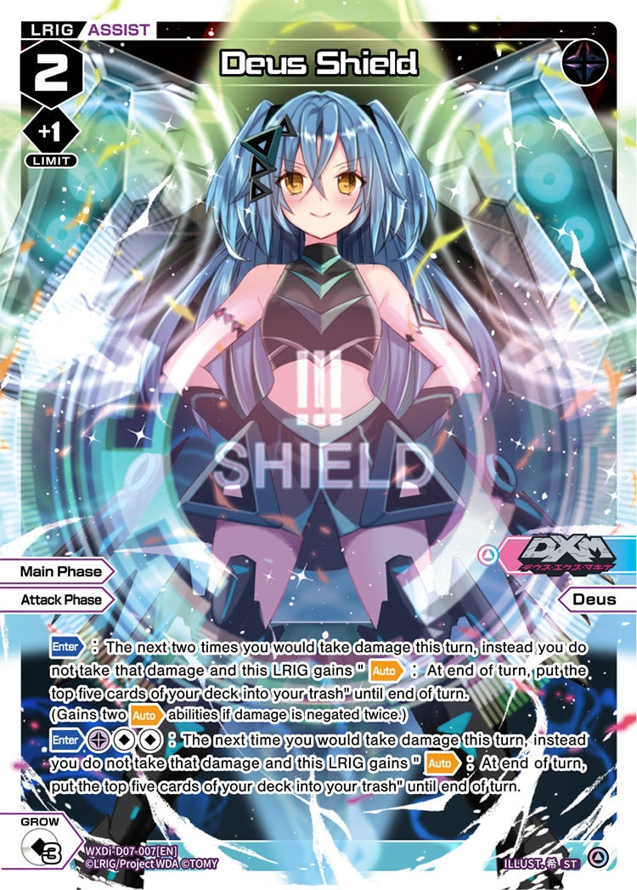

# Deus Shield

## Thông tin lá

| Trường | Giá trị |
| --- | --- |
| Mã in | WXDi-D07-007[EN] |
| Set | WXDi-D07[EN] |
| Loại thẻ | ASSIST LRIG |
| Vị trí | LRIG Deck |
| Số bản D07 | 1 |
| Màu | Đen |
| Độ hiếm | ST |
| Minh họa | 希 |
| Level | 2 |
| Limit | ＋1 |
| Power | 0 |
| LRIG type / Class | Deus |
| Team / Master | DEUS・EX・MACHINA |
| Cost | — |
| Grow cost | 《C》×３ |
| Use timing | Main Phase / Attack Phase |
| Life Burst | Không |

## Card text chính thức

[Enter]: The next two times you would take damage this turn, instead you do not take that damage and this LRIG gains "[Auto]: At end of turn, put the top five cards of your deck into your trash" until end of turn. (Gains two [Auto] abilities if damage is negated twice.)
[Enter] {Black} {Colorless} {Colorless}: The next time you would take damage this turn, instead you do not take that damage and this LRIG gains "[Auto]: At end of turn, put the top five cards of your deck into your trash" until end of turn.

## Power text / Life Burst

—

## Ghi chú minh họa
Artist: 希. Ảnh ST được tải từ Card List tiếng Anh.

## FAQ chính thức

**Q. If this card triggers both [Enter] abilities, what happens?**
A. The first [Enter] ability replaces damage twice. In addition, the second [Enter] ability replaces the damage once. So you prevent a total of three damages: the next time, the next time after that, and the next time after next. If you prevent three times, this card gains three abilities of "[Auto]: At end of turn, put the top five cards of your deck into your trash", so you put the top fifteen cards of your deck into your trash at the end of turn.

**Q. When I resolved the first [Auto] ability, then I prevented twice damage. So this card gains two abilities of "[Auto]: At end of turn, put the top five cards of your deck into your trash". At the end of turn, if the number of cards in my deck is four or less left, what happens?**
A. The two [Auto] abilities are triggered in order, and the first time you put all the four or less left cards in your trash. After that, since there are no cards in your deck before the second resolves, so you refresh your deck. After refreshing, resolve the second time and put the top five cards of your deck into your trash.

**Q. May [Enter] abilities prevent crush to my Life Cloth by 【Lancer】? Or for example, may [Enter] abilities prevent crush to my Life Cloth such the effect of "Crush one of your opponent's Life Cloth." by "DJ LOVIT - CROSSFADE", etc?**
A. No, you cannot prevent them. [Enter] abilities may prevent damage that would be dealt by attack. However, effects like "Crush one of your opponent's Life Cloth." cannot be prevented as they crush your Life Cloth without doing any damage. 【Lancer】 is when a SIGNI with 【Lancer】 vanishes an opponent's SIGNI in a battle, the effect of 【Lancer】 is triggered and the opponent's Life cloth is crushed. In addition, you don't replace the damage, so your LRIG doesn't get the ability to "put the top five cards of your deck into your trash".

**Q. May [Enter] abilities prevent crush to my Life Cloth by 【Double Crush】 or 【Assassin】?**
A. Yes, you may prevent them. 【Double Crush】 is when a SIGNI or LRIG with 【Double Crush】 attacks and deals damage to an opponent, it can crush two Life cloths at once. And 【Assassin】 is a SIGNI with 【Assassin】 can deal damage to an opponents when it attacks, as if there were no SIGNI in front of it. The damage that would be dealt by the attack, so you may prevent them by [Enter] abilities. In addition, since the damage that would be dealt by one attack of 【Double Crush】 is one, [Enter] ability gives your LRIG the ability to "put the top five cards of your deck into your trash" only once.

## Nguồn
[Card List/FAQ chính thức](https://www.takaratomy.co.jp/products/en.wixoss/card/card.html?card_no=WXDi-D07-007%5BEN%5D ) · [Ảnh thẻ](https://www.takaratomy.co.jp/products/en.wixoss/card/thumb/WXDi-D07-007%5BEN%5D.jpg)
