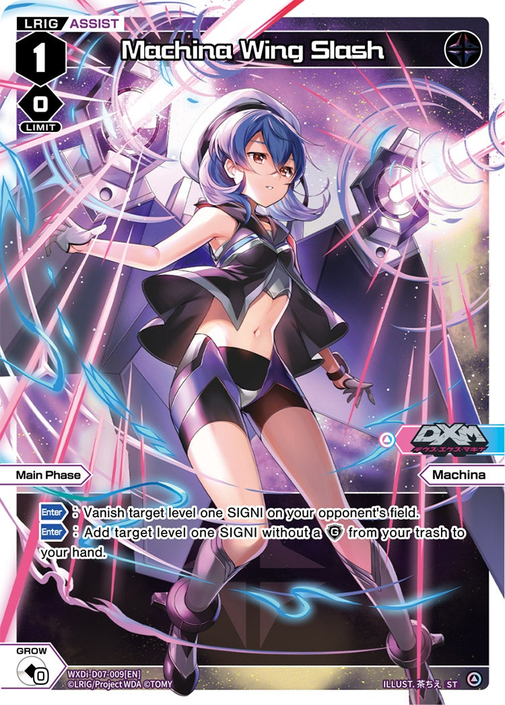

# Machina Wing Slash

## Thông tin lá

| Trường | Giá trị |
| --- | --- |
| Mã in | WXDi-D07-009[EN] |
| Set | WXDi-D07[EN] |
| Loại thẻ | ASSIST LRIG |
| Vị trí | LRIG Deck |
| Số bản D07 | 1 |
| Màu | Đen |
| Độ hiếm | ST |
| Minh họa | 茶ちえ |
| Level | 1 |
| Limit | 0 |
| Power | 0 |
| LRIG type / Class | Machina |
| Team / Master | DEUS・EX・MACHINA |
| Cost | — |
| Grow cost | 《C》×０ |
| Use timing | Main Phase |
| Life Burst | Không |

## Card text chính thức

[Enter]: Vanish target level one SIGNI on your opponent's field.
[Enter]: Add target level one SIGNI without a {Guard Icon} from your trash to your hand.

## Power text / Life Burst

—

## Ghi chú minh họa
Artist: 茶ちえ. Ảnh ST được tải từ Card List tiếng Anh.

## FAQ chính thức

**Q. Do this card's [Enter] abilities must to be triggered?**
A. Yes, [Enter] abilities that do not have cost are forced to be triggered. For example, if there are one or more level one SINIG on your opponent's field, even if you not want to vanish target SIGNI, you have to chose target and vanish SIGNI. The [Enter] second ability is similar, if there is a SIGNI that meets the conditions in your trash, you must add it from your trash to your hand .

## Nguồn
[Card List/FAQ chính thức](https://www.takaratomy.co.jp/products/en.wixoss/card/card.html?card_no=WXDi-D07-009%5BEN%5D ) · [Ảnh thẻ](https://www.takaratomy.co.jp/products/en.wixoss/card/thumb/WXDi-D07-009%5BEN%5D.jpg)
