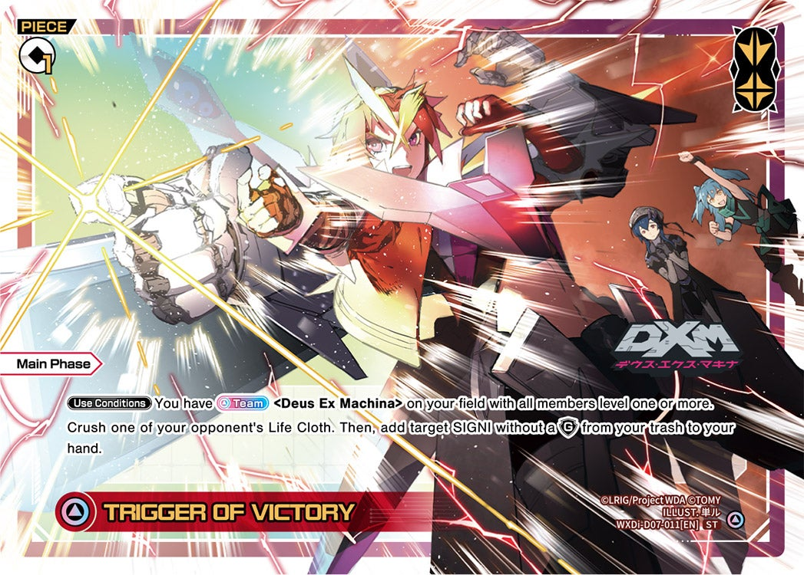

# TRIGGER OF VICTORY

## Thông tin lá

| Trường | Giá trị |
| --- | --- |
| Mã in | WXDi-D07-011[EN] |
| Set | WXDi-D07[EN] |
| Loại thẻ | PIECE |
| Vị trí | LRIG Deck |
| Số bản D07 | 1 |
| Màu | Đỏ / đen |
| Độ hiếm | ST,PR |
| Minh họa | 単ル |
| Level | — |
| Limit | — |
| Power | 0 |
| LRIG type / Class | — |
| Team / Master | — |
| Cost | 《C》×１ |
| Grow cost | — |
| Use timing | Main Phase |
| Life Burst | Không |

## Card text chính thức

[Use Conditions] You have [Team] <Deus Ex Machina> on your field with all members level one or more.

Crush one of your opponent's Life Cloth. Then, add target SIGNI without a {Guard Icon} from your trash to your hand.

## Power text / Life Burst

—

## Ghi chú minh họa
Artist: 単ル. Ảnh ST được tải từ Card List tiếng Anh.

## FAQ chính thức

**Q. A Life Burst of the card crashed by this PEACE, and the effect of I add target SIGNI from your trash to your hand by this PEACE. Which of a Life Burst and this effect of PEACE will be resolved first?**
A. A Life Burst of the crashed card is triggered, but it is not resolved in the middle of processing this PEACE's effect. First the effect of this PEACE is processed to the end, and then the Life Burst is resolved.

## Nguồn
[Card List/FAQ chính thức](https://www.takaratomy.co.jp/products/en.wixoss/card/card.html?card_no=WXDi-D07-011%5BEN%5D ) · [Ảnh thẻ](https://www.takaratomy.co.jp/products/en.wixoss/card/thumb/WXDi-D07-011%5BEN%5D.jpg)
