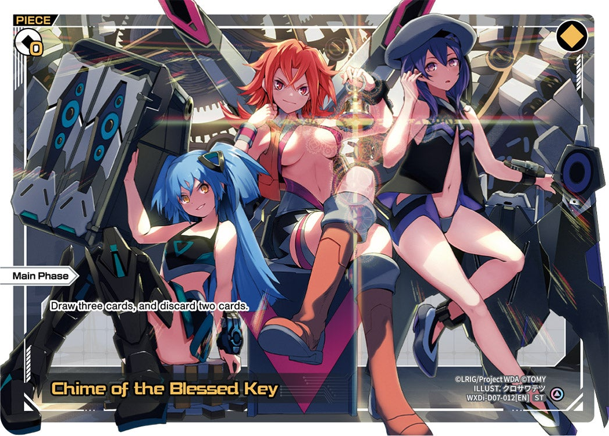

# Chime of the Blessed Key

## Thông tin lá

| Trường | Giá trị |
| --- | --- |
| Mã in | WXDi-D07-012[EN] |
| Set | WXDi-D07[EN] |
| Loại thẻ | PIECE |
| Vị trí | LRIG Deck |
| Số bản D07 | 1 |
| Màu | Không màu |
| Độ hiếm | ST,PR |
| Minh họa | クロサワテツ |
| Level | — |
| Limit | — |
| Power | 0 |
| LRIG type / Class | — |
| Team / Master | — |
| Cost | 《C》×０ |
| Grow cost | — |
| Use timing | Main Phase |
| Life Burst | Không |

## Card text chính thức

Draw three cards, and discard two cards.

## Power text / Life Burst

—

## Ghi chú minh họa
Artist: クロサワテツ. Ảnh ST được tải từ Card List tiếng Anh.

## FAQ chính thức

**Q. What happens if I play this PEACE when there are 2 cards or less than left in my deck?**
A. You may draw those two cards or less, and you discard two cards after drawing. Even if you can only draw a card, you must discard two cards.
After that, my deck not has cards, so refresh your deck.

## Nguồn
[Card List/FAQ chính thức](https://www.takaratomy.co.jp/products/en.wixoss/card/card.html?card_no=WXDi-D07-012%5BEN%5D ) · [Ảnh thẻ](https://www.takaratomy.co.jp/products/en.wixoss/card/thumb/WXDi-D07-012%5BEN%5D.jpg)
