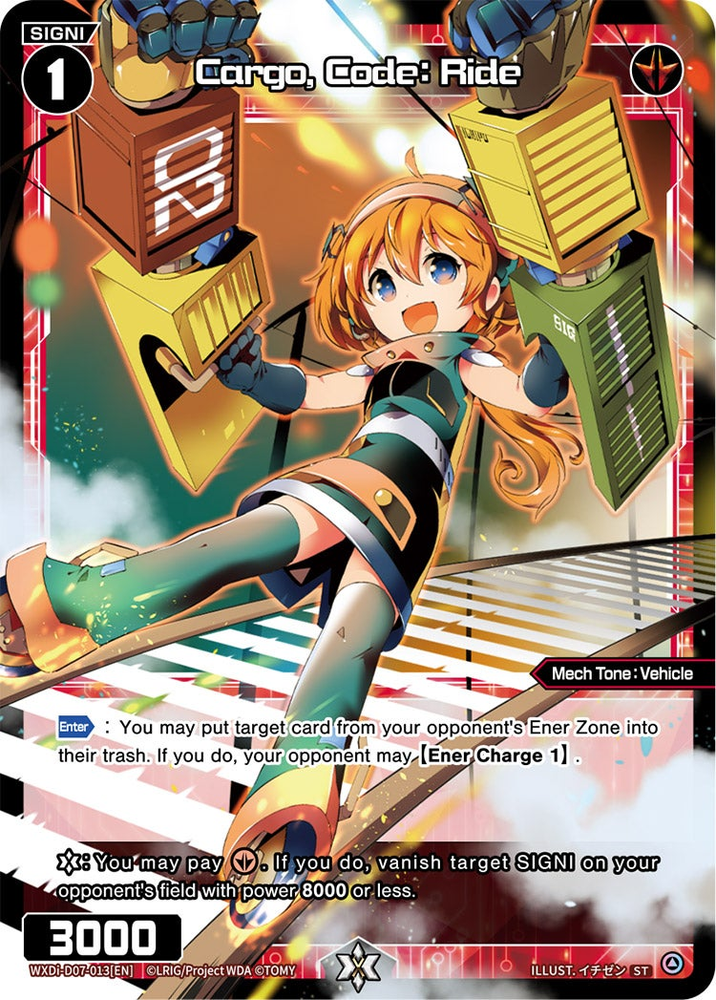

# Cargo, Code: Ride

## Thông tin lá

| Trường | Giá trị |
| --- | --- |
| Mã in | WXDi-D07-013[EN] |
| Set | WXDi-D07[EN] |
| Loại thẻ | SIGNI |
| Vị trí | Main Deck |
| Số bản D07 | 4 |
| Màu | Đỏ |
| Độ hiếm | ST |
| Minh họa | イチゼン |
| Level | 1 |
| Limit | — |
| Power | 3000 |
| LRIG type / Class | Mech Tone：Vehicle |
| Team / Master | — |
| Cost | — |
| Grow cost | — |
| Use timing | — |
| Life Burst | Có |

## Card text chính thức

[Enter]: You may put target card from your opponent's Ener Zone into their trash. If you do, your opponent may 【Ener Charge 1】.

## Power text / Life Burst

You may pay {Red}. If you do, vanish target SIGNI on your opponent's field with power 8000 or less.

## Ghi chú minh họa
Artist: イチゼン. Ảnh ST được tải từ Card List tiếng Anh.

## FAQ chính thức

**Q. Which player decides to 【Ener Charge 1】 by the [Enter] ability?**
A. Your opponent can decide whether to perform 【Energy Charge 1】.

## Nguồn
[Card List/FAQ chính thức](https://www.takaratomy.co.jp/products/en.wixoss/card/card.html?card_no=WXDi-D07-013%5BEN%5D ) · [Ảnh thẻ](https://www.takaratomy.co.jp/products/en.wixoss/card/thumb/WXDi-D07-013%5BEN%5D.jpg)
