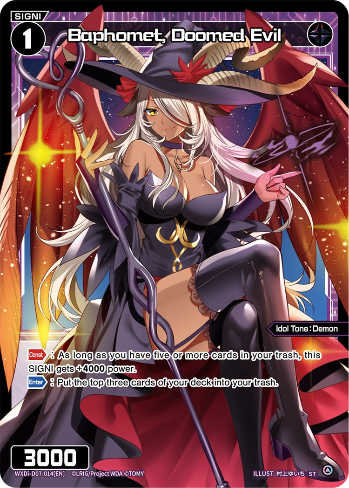

# Baphomet, Doomed Evil

## Thông tin lá

| Trường | Giá trị |
| --- | --- |
| Mã in | WXDi-D07-014[EN] |
| Set | WXDi-D07[EN] |
| Loại thẻ | SIGNI |
| Vị trí | Main Deck |
| Số bản D07 | 4 |
| Màu | Đen |
| Độ hiếm | ST |
| Minh họa | 村上ゆいち |
| Level | 1 |
| Limit | — |
| Power | 3000 |
| LRIG type / Class | Idol Tone：Demon |
| Team / Master | — |
| Cost | — |
| Grow cost | — |
| Use timing | — |
| Life Burst | Không |

## Card text chính thức

[Constant]: As long as you have five or more cards in your trash, this SIGNI gets +4000 power.
[Enter]: Put the top three cards of your deck into your trash.

## Power text / Life Burst

—

## Ghi chú minh họa
Artist: 村上ゆいち. Ảnh ST được tải từ Card List tiếng Anh.

## FAQ chính thức

**Q. Does this card's [Enter] ability must to be triggered?**
A. Yes, [Enter] abilities that do not have cost are forced to be triggered. For example, even if there are three cards or less left in your deck and you don't want to put the top three cards of your deck into your trash, you must to be triggered this [Enter] ability. In this case, you put three cards or less left in your deck into your trash. Then you refresh your deck becasu the number of cards in your deck are 0 cards.

## Nguồn
[Card List/FAQ chính thức](https://www.takaratomy.co.jp/products/en.wixoss/card/card.html?card_no=WXDi-D07-014%5BEN%5D ) · [Ảnh thẻ](https://www.takaratomy.co.jp/products/en.wixoss/card/thumb/WXDi-D07-014%5BEN%5D.jpg)
