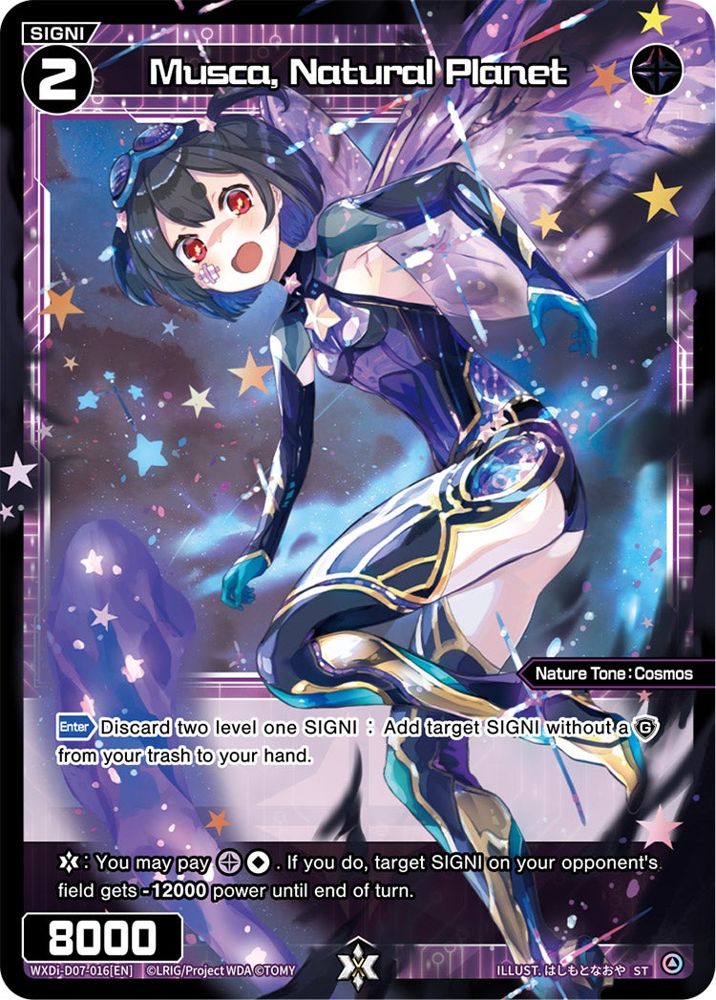

# Musca, Natural Planet

## Thông tin lá

| Trường | Giá trị |
| --- | --- |
| Mã in | WXDi-D07-016[EN] |
| Set | WXDi-D07[EN] |
| Loại thẻ | SIGNI |
| Vị trí | Main Deck |
| Số bản D07 | 4 |
| Màu | Đen |
| Độ hiếm | ST |
| Minh họa | はしもとなおや |
| Level | 2 |
| Limit | — |
| Power | 8000 |
| LRIG type / Class | Nature Tone：Cosmos |
| Team / Master | — |
| Cost | — |
| Grow cost | — |
| Use timing | — |
| Life Burst | Có |

## Card text chính thức

[Enter] Discard two level one SIGNI: Add target SIGNI without a {Guard Icon} from your trash to your hand.

## Power text / Life Burst

You may pay {Black} {Colorless}. If you do, target SIGNI on your opponent's field gets -12000 power until end of turn.

## Ghi chú minh họa
Artist: はしもとなおや. Ảnh ST được tải từ Card List tiếng Anh.

## FAQ chính thức

— (không có FAQ riêng cho mã này trên trang FAQ tiếng Anh.)

## Nguồn
[Card List/FAQ chính thức](https://www.takaratomy.co.jp/products/en.wixoss/card/card.html?card_no=WXDi-D07-016%5BEN%5D ) · [Ảnh thẻ](https://www.takaratomy.co.jp/products/en.wixoss/card/thumb/WXDi-D07-016%5BEN%5D.jpg)
