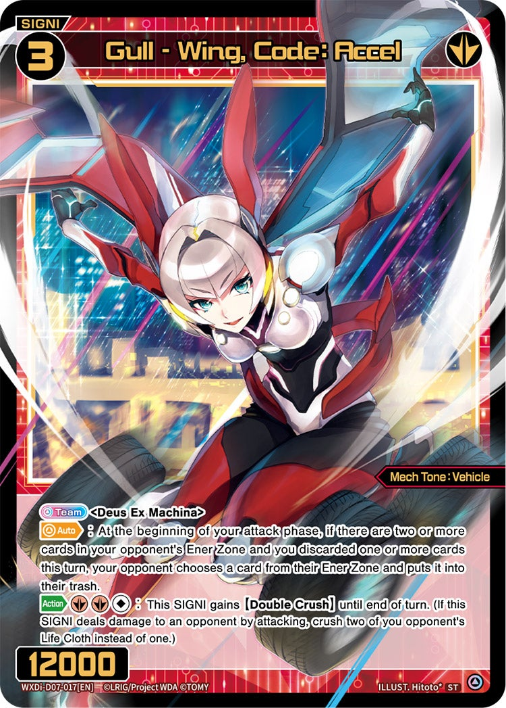

# Gull - Wing, Code: Accel

## Thông tin lá

| Trường | Giá trị |
| --- | --- |
| Mã in | WXDi-D07-017[EN] |
| Set | WXDi-D07[EN] |
| Loại thẻ | SIGNI |
| Vị trí | Main Deck |
| Số bản D07 | 4 |
| Màu | Đỏ |
| Độ hiếm | ST |
| Minh họa | Hitoto* |
| Level | 3 |
| Limit | — |
| Power | 12000 |
| LRIG type / Class | Mech Tone：Vehicle |
| Team / Master | — |
| Cost | — |
| Grow cost | — |
| Use timing | — |
| Life Burst | Không |

## Card text chính thức

[Team] <Deus Ex Machina>
[Team Auto]: At the beginning of your attack phase, if there are two or more cards in your opponent's Ener Zone and you discarded one or more cards this turn, your opponent chooses a card from their Ener Zone and puts it into their trash.
[Action] {Red} {Red} {Colorless}: This SIGNI gains 【Double Crush】 until end of turn. (If this SIGNI deals damage to an opponent by attacking, crush two of your opponent's Life Cloth instead of one.)

## Power text / Life Burst

—

## Ghi chú minh họa
Artist: Hitoto*. Ảnh ST được tải từ Card List tiếng Anh.

## FAQ chính thức

**Q. What does it mean by [Team]?**
A. It means the team indicated by that card. The [Team Auto], [Team Action], [Team Constant], and [Team Enter] abilities of the card are valid only if all 3 LRIGs in your field are the indicated . In the case of this card, if all three of your LRIGs are <Deus Ex Machina>, you will be able to use the ability.

**Q. I discarded a card and there is one card in my opponent's Ener Zone. At the beginning of my attack phase, my other SIGNI vanished my opponent's SIGNI when it was triggered some [Auto] ability. So there are two cards in my opponent's Ener Zone. Does this card's [Team Auto] ability trigger at the beginning of same my attack phase?**
A. Yes. At the beginning of your attack phase, [Team Auto] ability is also triggering. You can resolve it in any order by combining it with other abilities that trigger at the same time. You may vanish your opponent's SIGNI first with another ability triggered at the same timing, and you may then be processed [Team Auto] ability if condition is met. So you may process the effect of "your opponent chooses a card from their Ener Zone and puts it into their trash".

## Nguồn
[Card List/FAQ chính thức](https://www.takaratomy.co.jp/products/en.wixoss/card/card.html?card_no=WXDi-D07-017%5BEN%5D ) · [Ảnh thẻ](https://www.takaratomy.co.jp/products/en.wixoss/card/thumb/WXDi-D07-017%5BEN%5D.jpg)
