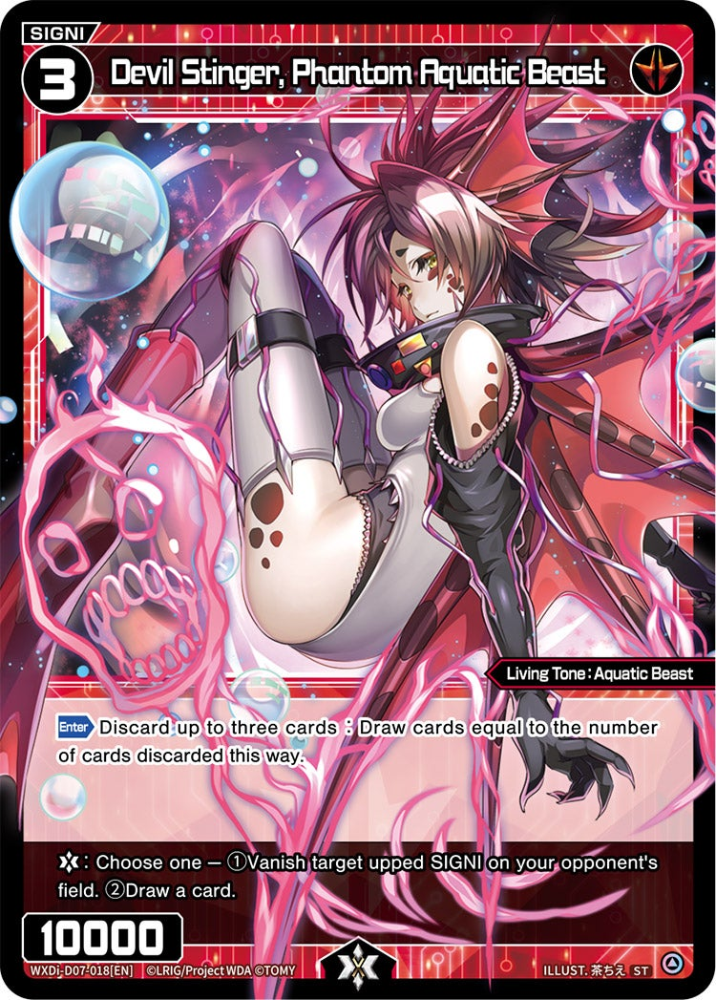

# Devil Stinger, Phantom Aquatic Beast

## Thông tin lá

| Trường | Giá trị |
| --- | --- |
| Mã in | WXDi-D07-018[EN] |
| Set | WXDi-D07[EN] |
| Loại thẻ | SIGNI |
| Vị trí | Main Deck |
| Số bản D07 | 4 |
| Màu | Đỏ |
| Độ hiếm | ST |
| Minh họa | 茶ちえ |
| Level | 3 |
| Limit | — |
| Power | 10000 |
| LRIG type / Class | Living Tone：Aquatic Beast |
| Team / Master | — |
| Cost | — |
| Grow cost | — |
| Use timing | — |
| Life Burst | Có |

## Card text chính thức

[Enter] Discard up to three cards: Draw cards equal to the number of cards discarded this way.

## Power text / Life Burst

Choose one — ①Vanish target upped SIGNI on your opponent's field. ②Draw a card.

## Ghi chú minh họa
Artist: 茶ちえ. Ảnh ST được tải từ Card List tiếng Anh.

## FAQ chính thức

**Q. Regarding [Enter] ability, may I choose not to discard any cards?**
A. Yes, you can.

**Q. With the [Enter] ability, may I choose to discard a card and then draw a card, and then discard the other and draw?**
A. No, you cannot choose. After discarding all the number of cards decided as the cost, you may draw the number of cards according to the number by the cost. It cannot be processed one by one.

## Nguồn
[Card List/FAQ chính thức](https://www.takaratomy.co.jp/products/en.wixoss/card/card.html?card_no=WXDi-D07-018%5BEN%5D ) · [Ảnh thẻ](https://www.takaratomy.co.jp/products/en.wixoss/card/thumb/WXDi-D07-018%5BEN%5D.jpg)
