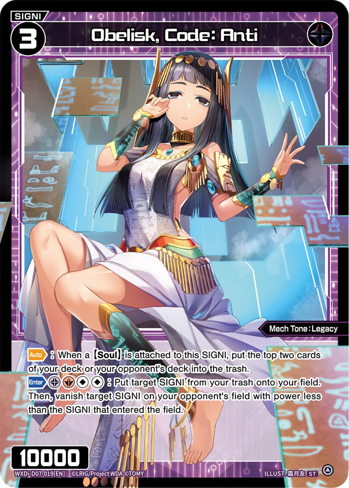

# Obelisk, Code: Anti

## Thông tin lá

| Trường | Giá trị |
| --- | --- |
| Mã in | WXDi-D07-019[EN] |
| Set | WXDi-D07[EN] |
| Loại thẻ | SIGNI |
| Vị trí | Main Deck |
| Số bản D07 | 4 |
| Màu | Đen |
| Độ hiếm | ST |
| Minh họa | 霜月友 |
| Level | 3 |
| Limit | — |
| Power | 10000 |
| LRIG type / Class | Mech Tone：Legacy |
| Team / Master | — |
| Cost | — |
| Grow cost | — |
| Use timing | — |
| Life Burst | Không |

## Card text chính thức

[Auto]: When a 【Soul】 is attached to this SIGNI, put the top two cards of your deck or your opponent's deck into their owner's trash.
[Enter] {Black} {Red} {Colorless} {Colorless}: Put target SIGNI from your trash onto your field. Then, vanish target SIGNI on your opponent's field with power less than the SIGNI that entered the field.

## Power text / Life Burst

—

## Ghi chú minh họa
Artist: 霜月友. Ảnh ST được tải từ Card List tiếng Anh.

## FAQ chính thức

**Q. What is 【Soul】?**
A. LRIG may be attached to SIGNI as 【Soul】 by effect. You cannot attach more than two 【Soul】 on a SIGNI. If the SIGNI with a 【Soul】 attached to it leaves the field, 【Soul】 will be put into its owner's LRIG trash by Rule-based action.

**Q. If you pay cost to play [Enter] ability, may I target a card that I paid for as a cost and put it on my field?**
A. Yes, you can. The procedure is to pay the Ener Cost and target a SIGNI in your trash after those cards are put in the trash.

**Q. When I put a SIGNI with [Enter] ability onto my field from my trash by this [Enter] ability, "Then, vanish target SIGNI on your opponent's field with power less than the SIGNI that entered the field.", and that SIGNI's [Enter] ability, which one will be resolved first?**
A. You will be process "Then, vanish target SIGNI on your opponent's field with power less than the SIGNI that entered the field" first. When that SIGNI with [Enter] ability put onto your field, its [Enter] ability triggers. However, that SIGNI's [Enter] ability can only be resolved after processing the effects of this card to the end. For example, if you put "Vassago, Jade Evil" onto your field by this card, you need resolve vanish target SIGNI on your opponent's field with power less than "Vassago, Jade Evil" first, then "Vassago, Jade Evil" gets +3000 power.

**Q. When "Michael, Blessed Angel" is in the left SIGNI Zone, I played [Enter] ability and put target SIGNI from my trash onto center SIGNI Zone. Then, I target your opponent's SIGNI with power less then your SIGNI that entered the field and vanish your opponent's SIGNI. In this case, how is [Enter] ability does if my SIGNI in the center SIGNI Zone gets +3000 by "Michael, Blessed Angel"?**
A. Your center SIGNI gets +3000 is [Constant] ability by "Michael, Blessed Angel", so if the condition for its ability is met, your SIGNI in the center SIGNI Zone is applied immediately. In this case, you may vanish target your opponent's SIGNI with power less then your SIGNI's that gets +3000 power.

## Nguồn
[Card List/FAQ chính thức](https://www.takaratomy.co.jp/products/en.wixoss/card/card.html?card_no=WXDi-D07-019%5BEN%5D ) · [Ảnh thẻ](https://www.takaratomy.co.jp/products/en.wixoss/card/thumb/WXDi-D07-019%5BEN%5D.jpg)
