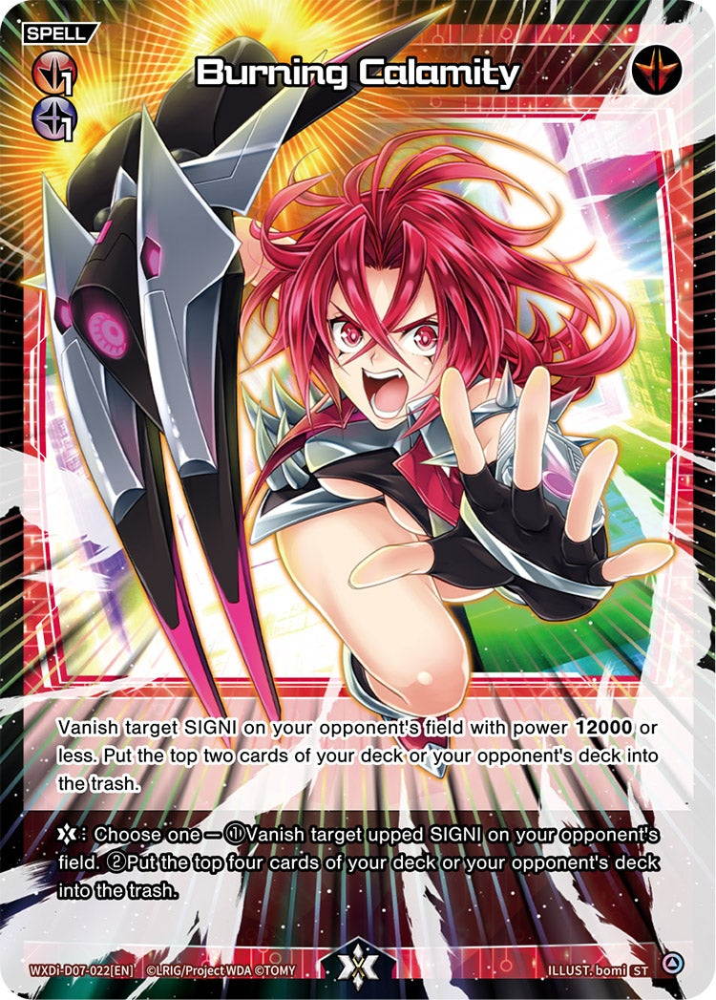

# Burning Calamity

## Thông tin lá

| Trường | Giá trị |
| --- | --- |
| Mã in | WXDi-D07-022[EN] |
| Set | WXDi-D07[EN] |
| Loại thẻ | SPELL |
| Vị trí | Main Deck |
| Số bản D07 | 4 |
| Màu | Đỏ |
| Độ hiếm | ST |
| Minh họa | bomi |
| Level | — |
| Limit | — |
| Power | 0 |
| LRIG type / Class | — |
| Team / Master | — |
| Cost | 《R》×１
《B》×１ |
| Grow cost | — |
| Use timing | — |
| Life Burst | Có |

## Card text chính thức

Vanish target SIGNI on your opponent's field with power 12000 or less. Put the top two cards of your deck or your opponent's deck into their owner's trash.

## Power text / Life Burst

Choose one — ①Vanish target upped SIGNI on your opponent's field. ②Put the top four cards of your deck or your opponent's deck into the trash.

## Ghi chú minh họa
Artist: bomi. Ảnh ST được tải từ Card List tiếng Anh.

## FAQ chính thức

**Q. When I played this Spell, May I put the top two cards of my deck or my opponent's deck into the trash if my opponent's field has no SIGNI?**
A. Yes, you can.

## Nguồn
[Card List/FAQ chính thức](https://www.takaratomy.co.jp/products/en.wixoss/card/card.html?card_no=WXDi-D07-022%5BEN%5D ) · [Ảnh thẻ](https://www.takaratomy.co.jp/products/en.wixoss/card/thumb/WXDi-D07-022%5BEN%5D.jpg)
