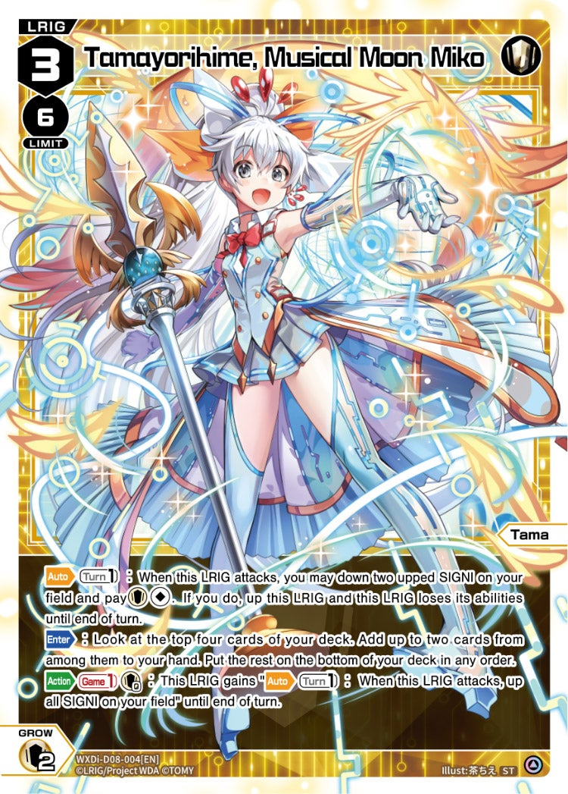

# Tamayorihime, Musical Moon Miko

## Thông tin lá

| Trường | Giá trị |
| --- | --- |
| Mã in | WXDi-D08-004[EN] |
| Set | WXDi-D08[EN] |
| Loại thẻ | LRIG |
| Vị trí | LRIG Deck |
| Số bản D08 | 1 |
| Màu | Trắng |
| Độ hiếm | ST,LR,LRP,UR |
| Minh họa | 茶ちえ |
| Level | 3 |
| Limit | 6 |
| Power | 0 |
| LRIG type / Class | Tama |
| Team / Master | — |
| Cost | — |
| Grow cost | 《W》×２ |
| Use timing | — |
| Life Burst | Không |

## Card text chính thức

[Auto] {1/Turn}: When this LRIG attacks, you may down two upped SIGNI on your field and pay {White} {Colorless}. If you do, up this LRIG and this LRIG loses its abilities until end of turn.
[Enter]: Look at the top four cards of your deck. Add up to two cards from among them to your hand. Put the rest on the bottom of your deck in any order.
[Action] {1/Game} {Whitex0}: This LRIG gains "[Auto] {1/Turn}: When this LRIG attacks, up all SIGNI on your field" until end of turn.

## Power text / Life Burst

—

## Ghi chú minh họa
Artist: 茶ちえ. Ảnh ST được tải từ Card List tiếng Anh.

## FAQ chính thức

**Q. After using the [Action] ability, this LRIG attacked. This LRIG has two [Auto] abilities when I attacked, may I resolve the second [Auto] ability first to up all SIGNI and then use the first [Auto] ability to down them and up this LRIG?**
A. Yes, you can. If there are more than one [Auto] abilities triggered when LRIG or SIGNI attack, they can be triggered in any order.

## Ảnh biến thể

- [LR](../images/WXDi-D08-004R-EN.jpg)
- [LRP](../images/WXDi-D08-004P-EN.jpg)
- [UR](../images/WXDi-D08-004U-EN.jpg)

## Nguồn
[Card List/FAQ chính thức](https://www.takaratomy.co.jp/products/en.wixoss/card/card.html?card_no=WXDi-D08-004%5BEN%5D ) · [Ảnh thẻ](https://www.takaratomy.co.jp/products/en.wixoss/card/thumb/WXDi-D08-004%5BEN%5D.jpg)
