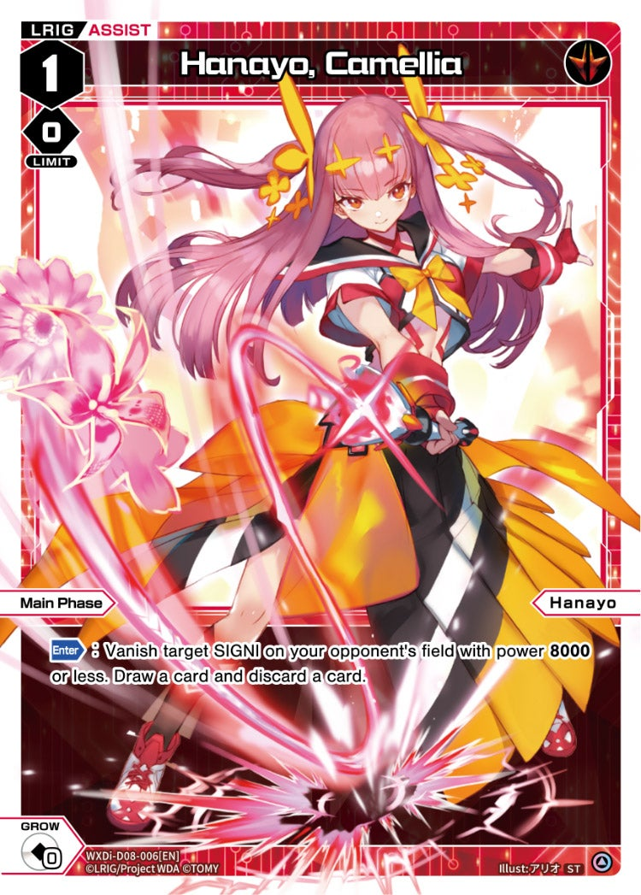

# Hanayo, Camellia

## Thông tin lá

| Trường | Giá trị |
| --- | --- |
| Mã in | WXDi-D08-006[EN] |
| Set | WXDi-D08[EN] |
| Loại thẻ | ASSIST LRIG |
| Vị trí | LRIG Deck |
| Số bản D08 | 1 |
| Màu | Đỏ |
| Độ hiếm | ST,ST(P) |
| Minh họa | アリオ |
| Level | 1 |
| Limit | 0 |
| Power | 0 |
| LRIG type / Class | Hanayo |
| Team / Master | — |
| Cost | — |
| Grow cost | 《C》×０ |
| Use timing | Main Phase |
| Life Burst | Không |

## Card text chính thức

[Enter]: Vanish target SIGNI on your opponent's field with power 8000 or less. Draw a card and discard a card.

## Power text / Life Burst

—

## Ghi chú minh họa
Artist: アリオ. Ảnh ST được tải từ Card List tiếng Anh.

## FAQ chính thức

**Q. May I draw a card even if there are no SIGNI on my opponent's field?**
A. Yes, you can. Even if you cannot vanish your opponent's SIGNI, the latter effect is still processed.

## Ảnh biến thể

- [ST(P)](../images/WXDi-D08-006P-EN.jpg)

## Nguồn
[Card List/FAQ chính thức](https://www.takaratomy.co.jp/products/en.wixoss/card/card.html?card_no=WXDi-D08-006%5BEN%5D ) · [Ảnh thẻ](https://www.takaratomy.co.jp/products/en.wixoss/card/thumb/WXDi-D08-006%5BEN%5D.jpg)
