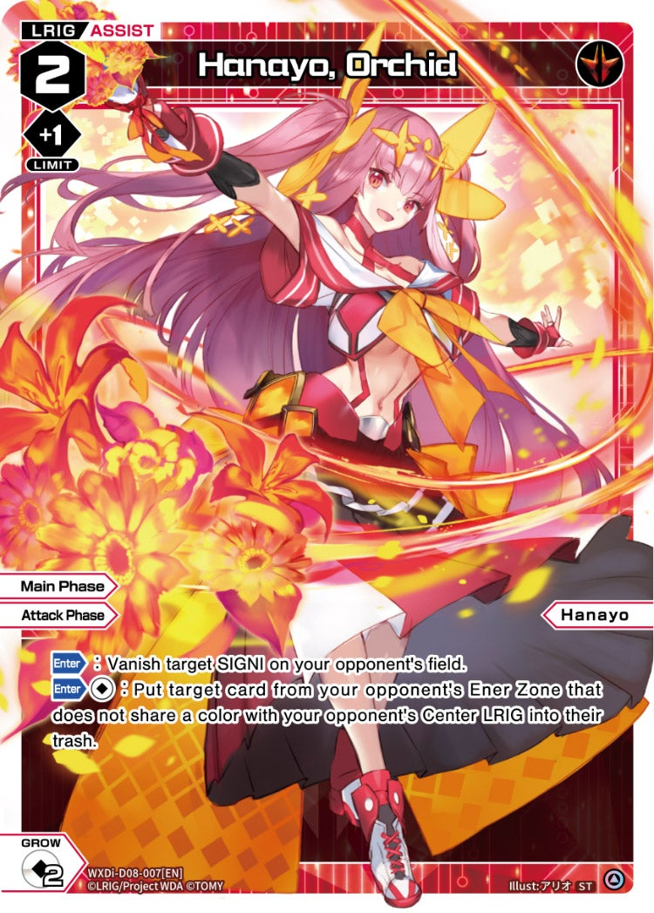

# Hanayo, Orchid

## Thông tin lá

| Trường | Giá trị |
| --- | --- |
| Mã in | WXDi-D08-007[EN] |
| Set | WXDi-D08[EN] |
| Loại thẻ | ASSIST LRIG |
| Vị trí | LRIG Deck |
| Số bản D08 | 1 |
| Màu | Đỏ |
| Độ hiếm | ST,ST(P) |
| Minh họa | アリオ |
| Level | 2 |
| Limit | ＋１ |
| Power | 0 |
| LRIG type / Class | Hanayo |
| Team / Master | — |
| Cost | — |
| Grow cost | 《C》×２ |
| Use timing | Main Phase / Attack Phase |
| Life Burst | Không |

## Card text chính thức

[Enter]: Vanish target SIGNI on your opponent's field.
[Enter] {Colorless}: Put target card from your opponent's Ener Zone that does not share a color with your opponent's Center LRIG into their trash.

## Power text / Life Burst

—

## Ghi chú minh họa
Artist: アリオ. Ảnh ST được tải từ Card List tiếng Anh.

## FAQ chính thức

**Q. May I use this [Auto] ability to put a 《Servant ♯》 in my opponent's Ener zone into its owner's trash?**
A. Yes, you can put it into its owner's trash. Colorless SIGNI dose not have color, so it has no colors in common with any of LRIGs.

## Ảnh biến thể

- [ST(P)](../images/WXDi-D08-007P-EN.jpg)

## Nguồn
[Card List/FAQ chính thức](https://www.takaratomy.co.jp/products/en.wixoss/card/card.html?card_no=WXDi-D08-007%5BEN%5D ) · [Ảnh thẻ](https://www.takaratomy.co.jp/products/en.wixoss/card/thumb/WXDi-D08-007%5BEN%5D.jpg)
