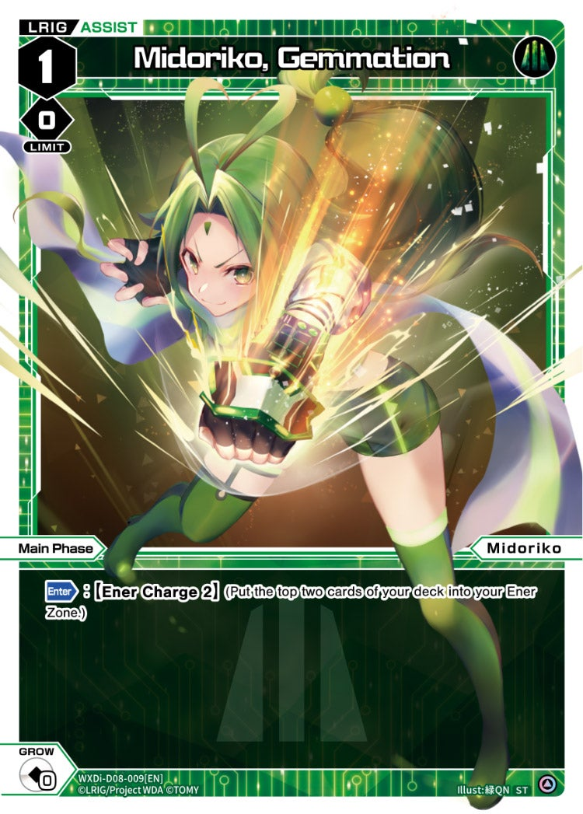

# Midoriko, Gemmation

## Thông tin lá

| Trường | Giá trị |
| --- | --- |
| Mã in | WXDi-D08-009[EN] |
| Set | WXDi-D08[EN] |
| Loại thẻ | ASSIST LRIG |
| Vị trí | LRIG Deck |
| Số bản D08 | 1 |
| Màu | Xanh lá |
| Độ hiếm | ST,ST(P) |
| Minh họa | 緑QN |
| Level | 1 |
| Limit | 0 |
| Power | 0 |
| LRIG type / Class | Midoriko |
| Team / Master | — |
| Cost | — |
| Grow cost | 《C》×０ |
| Use timing | Main Phase |
| Life Burst | Không |

## Card text chính thức

[Enter]: 【Ener Charge 2】 (Put the top two cards of your deck into your Ener Zone.)

## Power text / Life Burst

—

## Ghi chú minh họa
Artist: 緑QN. Ảnh ST được tải từ Card List tiếng Anh.

## FAQ chính thức

— (không có FAQ riêng cho mã này trên trang FAQ tiếng Anh.)

## Ảnh biến thể

- [ST(P)](../images/WXDi-D08-009P-EN.jpg)

## Nguồn
[Card List/FAQ chính thức](https://www.takaratomy.co.jp/products/en.wixoss/card/card.html?card_no=WXDi-D08-009%5BEN%5D ) · [Ảnh thẻ](https://www.takaratomy.co.jp/products/en.wixoss/card/thumb/WXDi-D08-009%5BEN%5D.jpg)
