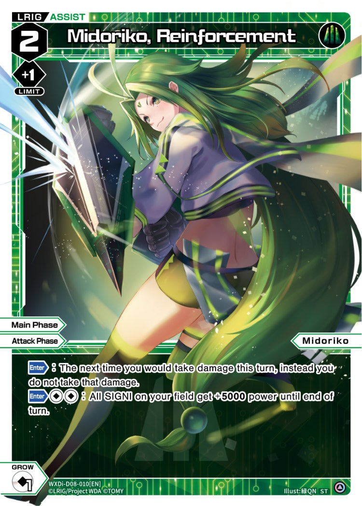

# Midoriko, Reinforcement

## Thông tin lá

| Trường | Giá trị |
| --- | --- |
| Mã in | WXDi-D08-010[EN] |
| Set | WXDi-D08[EN] |
| Loại thẻ | ASSIST LRIG |
| Vị trí | LRIG Deck |
| Số bản D08 | 1 |
| Màu | Xanh lá |
| Độ hiếm | ST,ST(P) |
| Minh họa | 緑QN |
| Level | 2 |
| Limit | ＋１ |
| Power | 0 |
| LRIG type / Class | Midoriko |
| Team / Master | — |
| Cost | — |
| Grow cost | 《C》×１ |
| Use timing | Main Phase / Attack Phase |
| Life Burst | Không |

## Card text chính thức

[Enter]: The next time you would take damage this turn, instead you do not take that damage.
[Enter] {Colorless} {Colorless}: All SIGNI on your field get +5000 power until end of turn.

## Power text / Life Burst

—

## Ghi chú minh họa
Artist: 緑QN. Ảnh ST được tải từ Card List tiếng Anh.

## FAQ chính thức

— (không có FAQ riêng cho mã này trên trang FAQ tiếng Anh.)

## Ảnh biến thể

- [ST(P)](../images/WXDi-D08-010P-EN.jpg)

## Nguồn
[Card List/FAQ chính thức](https://www.takaratomy.co.jp/products/en.wixoss/card/card.html?card_no=WXDi-D08-010%5BEN%5D ) · [Ảnh thẻ](https://www.takaratomy.co.jp/products/en.wixoss/card/thumb/WXDi-D08-010%5BEN%5D.jpg)
