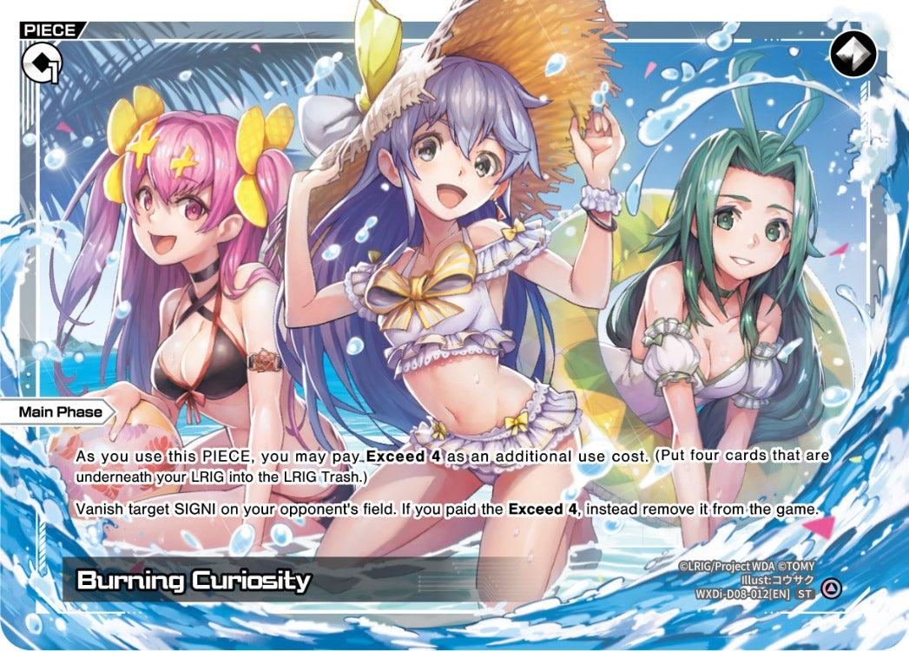

# Burning Curiosity

## Thông tin lá

| Trường | Giá trị |
| --- | --- |
| Mã in | WXDi-D08-012[EN] |
| Set | WXDi-D08[EN] |
| Loại thẻ | PIECE |
| Vị trí | LRIG Deck |
| Số bản D08 | 1 |
| Màu | Không màu |
| Độ hiếm | ST,ST(P) |
| Minh họa | コウサク |
| Level | — |
| Limit | — |
| Power | 0 |
| LRIG type / Class | — |
| Team / Master | — |
| Cost | 《C》×１ |
| Grow cost | — |
| Use timing | Main Phase |
| Life Burst | Không |

## Card text chính thức

As you use this PIECE, you may pay Exceed 4 as an additional use cost. (Put four cards that are underneath your LRIG into the LRIG Trash.)

Vanish target SIGNI on your opponent's field. If you paid the Exceed 4, instead remove it from the game.

## Power text / Life Burst

—

## Ghi chú minh họa
Artist: コウサク. Ảnh ST được tải từ Card List tiếng Anh.

## FAQ chính thức

**Q. I used this PIECE and target a SIGNI with the "cannot be vanished" ability as paid Exceed 4. May I remove that SIGNI from the game?**
A. Yes, you can.

## Ảnh biến thể

- [ST(P)](../images/WXDi-D08-012P-EN.jpg)

## Nguồn
[Card List/FAQ chính thức](https://www.takaratomy.co.jp/products/en.wixoss/card/card.html?card_no=WXDi-D08-012%5BEN%5D ) · [Ảnh thẻ](https://www.takaratomy.co.jp/products/en.wixoss/card/thumb/WXDi-D08-012%5BEN%5D.jpg)
