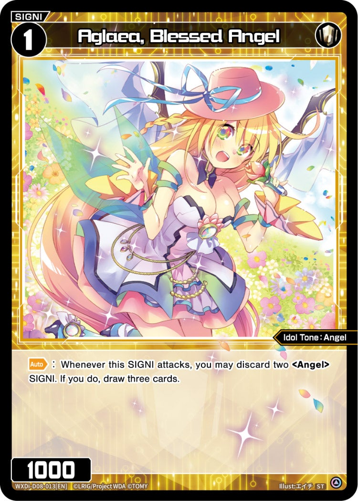

# Aglaea, Blessed Angel

## Thông tin lá

| Trường | Giá trị |
| --- | --- |
| Mã in | WXDi-D08-013[EN] |
| Set | WXDi-D08[EN] |
| Loại thẻ | SIGNI |
| Vị trí | Main Deck |
| Số bản D08 | 4 |
| Màu | Trắng |
| Độ hiếm | ST |
| Minh họa | エイチ |
| Level | 1 |
| Limit | — |
| Power | 1000 |
| LRIG type / Class | Idol Tone：Angel |
| Team / Master | — |
| Cost | — |
| Grow cost | — |
| Use timing | — |
| Life Burst | Không |

## Card text chính thức

[Auto]: Whenever this SIGNI attacks, you may discard two <Angel> SIGNI. If you do, draw three cards.

## Power text / Life Burst

—

## Ghi chú minh họa
Artist: エイチ. Ảnh ST được tải từ Card List tiếng Anh.

## FAQ chính thức

**Q. What happens if there is one or less <Angel> SIGNI in my hand when this SIGNI attacks?**
A. In this case, you cannot discard a <Angel> SIGNI card and you cannot draw a card.

## Nguồn
[Card List/FAQ chính thức](https://www.takaratomy.co.jp/products/en.wixoss/card/card.html?card_no=WXDi-D08-013%5BEN%5D ) · [Ảnh thẻ](https://www.takaratomy.co.jp/products/en.wixoss/card/thumb/WXDi-D08-013%5BEN%5D.jpg)
