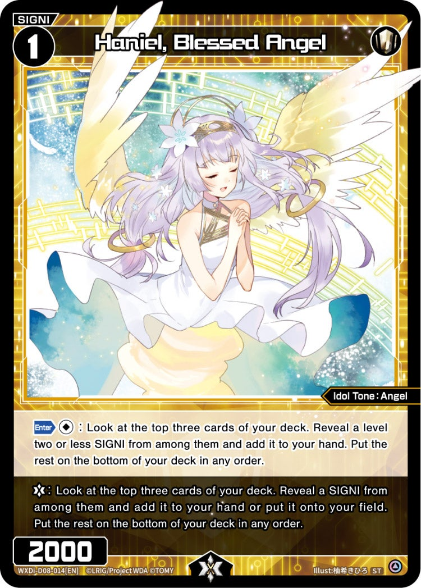

# Haniel, Blessed Angel

## Thông tin lá

| Trường | Giá trị |
| --- | --- |
| Mã in | WXDi-D08-014[EN] |
| Set | WXDi-D08[EN] |
| Loại thẻ | SIGNI |
| Vị trí | Main Deck |
| Số bản D08 | 4 |
| Màu | Trắng |
| Độ hiếm | ST |
| Minh họa | 柚希きひろ |
| Level | 1 |
| Limit | — |
| Power | 2000 |
| LRIG type / Class | Idol Tone：Angel |
| Team / Master | — |
| Cost | — |
| Grow cost | — |
| Use timing | — |
| Life Burst | Có |

## Card text chính thức

[Enter] {Colorless}: Look at the top three cards of your deck. Reveal a level two or less SIGNI from among them and add it to your hand. Put the rest on the bottom of your deck in any order.

## Power text / Life Burst

Look at the top three cards of your deck. Reveal a SIGNI from among them and add it to your hand or put it onto your field. Put the rest on the bottom of your deck in any order.

## Ghi chú minh họa
Artist: 柚希きひろ. Ảnh ST được tải từ Card List tiếng Anh.

## FAQ chính thức

**Q. What happens if there are three or less cards in my deck when the [Enter] ability or Life Burst is triggered?**
A. In that case, you look at those three or less cards and the effect is processed. If one or more cards remains in your deck after the effect is processed, you don't refresh your deck.

## Nguồn
[Card List/FAQ chính thức](https://www.takaratomy.co.jp/products/en.wixoss/card/card.html?card_no=WXDi-D08-014%5BEN%5D ) · [Ảnh thẻ](https://www.takaratomy.co.jp/products/en.wixoss/card/thumb/WXDi-D08-014%5BEN%5D.jpg)
