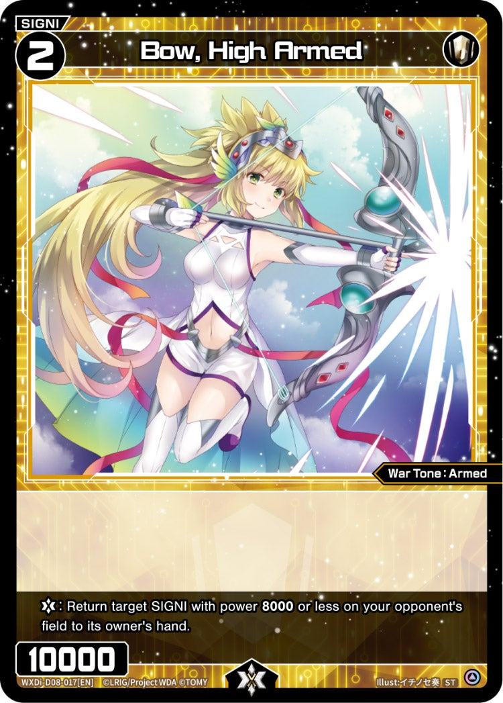

# Bow, High Armed

## Thông tin lá

| Trường | Giá trị |
| --- | --- |
| Mã in | WXDi-D08-017[EN] |
| Set | WXDi-D08[EN] |
| Loại thẻ | SIGNI |
| Vị trí | Main Deck |
| Số bản D08 | 4 |
| Màu | Trắng |
| Độ hiếm | ST |
| Minh họa | イチノセ奏 |
| Level | 2 |
| Limit | — |
| Power | 10000 |
| LRIG type / Class | War Tone：Armed |
| Team / Master | — |
| Cost | — |
| Grow cost | — |
| Use timing | — |
| Life Burst | Có |

## Card text chính thức

—

## Power text / Life Burst

Return target SIGNI with power 8000 or less on your opponent's field to its owner's hand.

## Ghi chú minh họa
Artist: イチノセ奏. Ảnh ST được tải từ Card List tiếng Anh.

## FAQ chính thức

— (không có FAQ riêng cho mã này trên trang FAQ tiếng Anh.)

## Nguồn
[Card List/FAQ chính thức](https://www.takaratomy.co.jp/products/en.wixoss/card/card.html?card_no=WXDi-D08-017%5BEN%5D ) · [Ảnh thẻ](https://www.takaratomy.co.jp/products/en.wixoss/card/thumb/WXDi-D08-017%5BEN%5D.jpg)
