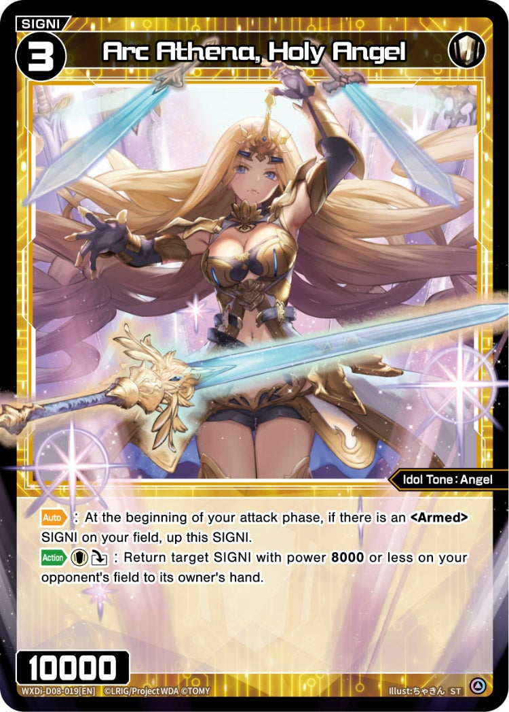

# Arc Athena, Holy Angel

## Thông tin lá

| Trường | Giá trị |
| --- | --- |
| Mã in | WXDi-D08-019[EN] |
| Set | WXDi-D08[EN] |
| Loại thẻ | SIGNI |
| Vị trí | Main Deck |
| Số bản D08 | 4 |
| Màu | Trắng |
| Độ hiếm | ST,ST(P) |
| Minh họa | ちゃきん |
| Level | 3 |
| Limit | — |
| Power | 10000 |
| LRIG type / Class | Idol Tone：Angel |
| Team / Master | — |
| Cost | — |
| Grow cost | — |
| Use timing | — |
| Life Burst | Không |

## Card text chính thức

[Auto]: At the beginning of your attack phase, if there is an <Armed> SIGNI on your field, up this SIGNI.
[Action] {White} {Down}: Return target SIGNI with power 8000 or less on your opponent's field to its owner's hand.

## Power text / Life Burst

—

## Ghi chú minh họa
Artist: ちゃきん. Ảnh ST được tải từ Card List tiếng Anh.

## FAQ chính thức

— (không có FAQ riêng cho mã này trên trang FAQ tiếng Anh.)

## Ảnh biến thể

- [ST(P)](../images/WXDi-D08-019P-EN.jpg)

## Nguồn
[Card List/FAQ chính thức](https://www.takaratomy.co.jp/products/en.wixoss/card/card.html?card_no=WXDi-D08-019%5BEN%5D ) · [Ảnh thẻ](https://www.takaratomy.co.jp/products/en.wixoss/card/thumb/WXDi-D08-019%5BEN%5D.jpg)
