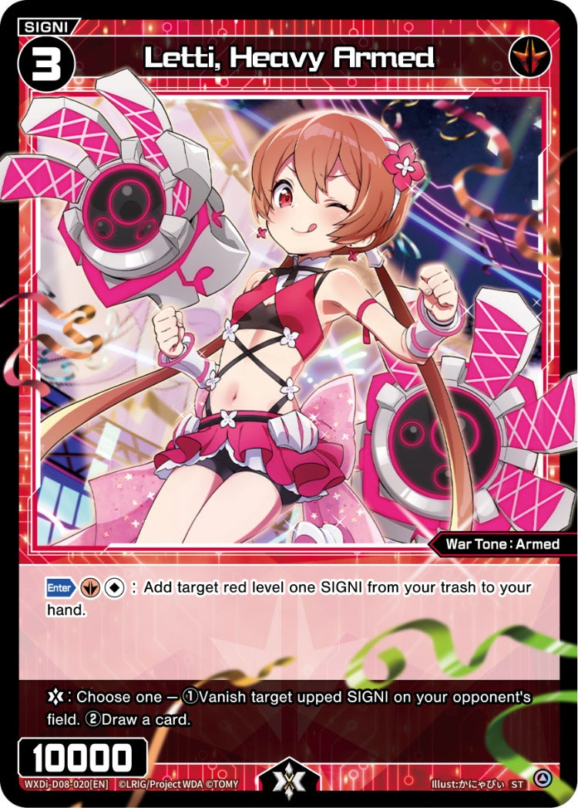

# Letti, Heavy Armed

## Thông tin lá

| Trường | Giá trị |
| --- | --- |
| Mã in | WXDi-D08-020[EN] |
| Set | WXDi-D08[EN] |
| Loại thẻ | SIGNI |
| Vị trí | Main Deck |
| Số bản D08 | 3 |
| Màu | Đỏ |
| Độ hiếm | ST,ST(P) |
| Minh họa | かにゃぴぃ |
| Level | 3 |
| Limit | — |
| Power | 10000 |
| LRIG type / Class | War Tone：Armed |
| Team / Master | — |
| Cost | — |
| Grow cost | — |
| Use timing | — |
| Life Burst | Có |

## Card text chính thức

[Enter] {Red} {Colorless}: Add target red level one SIGNI from your trash to your hand.

## Power text / Life Burst

Choose one — ①Vanish target upped SIGNI on your opponent's field. ②Draw a card.

## Ghi chú minh họa
Artist: かにゃぴぃ. Ảnh ST được tải từ Card List tiếng Anh.

## FAQ chính thức

**Q. May a card paid as the Ener cost of the [Enter] ability be targeted by this effect and put it into my hand?**
A. Yes, you can. You may put target card into your hand as long as it meets the conditions after you paid the Ener cost of the [Enter] ability.

**Q. May I add a card that paid for as the Ener cost of this [Enter] ability to my hand?**
A. Yes, you can. After paying the Ener cost of the [Enter] ability, target a SIGNI that matches the condition in your trash.

## Ảnh biến thể

- [ST(P)](../images/WXDi-D08-020P-EN.jpg)

## Nguồn
[Card List/FAQ chính thức](https://www.takaratomy.co.jp/products/en.wixoss/card/card.html?card_no=WXDi-D08-020%5BEN%5D ) · [Ảnh thẻ](https://www.takaratomy.co.jp/products/en.wixoss/card/thumb/WXDi-D08-020%5BEN%5D.jpg)
