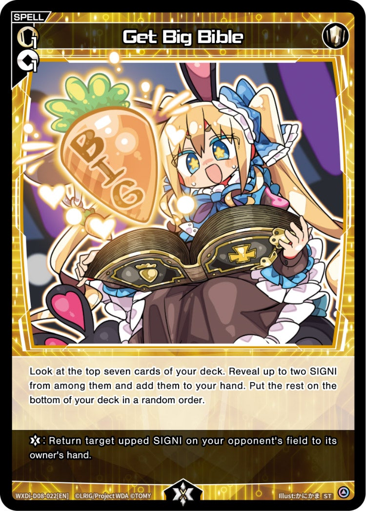

# Get Big Bible

## Thông tin lá

| Trường | Giá trị |
| --- | --- |
| Mã in | WXDi-D08-022[EN] |
| Set | WXDi-D08[EN] |
| Loại thẻ | SPELL |
| Vị trí | Main Deck |
| Số bản D08 | 4 |
| Màu | Trắng |
| Độ hiếm | ST,ST(P) |
| Minh họa | かにかま |
| Level | — |
| Limit | — |
| Power | 0 |
| LRIG type / Class | — |
| Team / Master | — |
| Cost | 《W》×１
《C》×１ |
| Grow cost | — |
| Use timing | — |
| Life Burst | Có |

## Card text chính thức

Look at the top seven cards of your deck. Reveal up to two SIGNI from among them and add them to your hand. Put the rest on the bottom of your deck in a random order.

## Power text / Life Burst

Return target upped SIGNI on your opponent's field to its owner's hand.

## Ghi chú minh họa
Artist: かにかま. Ảnh ST được tải từ Card List tiếng Anh.

## FAQ chính thức

**Q. What happens if I have less than 7 cards in my deck when I use this spell?**
A. In that case, the effect is processed by looking at those 7 cards or less. If there is more than one card left in the deck after the effect is processed, no refreshment is performed.

**Q. What happens if there are seven or less cards in my deck when this spell is used?**
A. In that case, you look at those seven or less cards and the effect is processed. If one or more cards remains in your deck after the effect is processed, you don't refresh your deck.

## Ảnh biến thể

- [ST(P)](../images/WXDi-D08-022P-EN.jpg)

## Nguồn
[Card List/FAQ chính thức](https://www.takaratomy.co.jp/products/en.wixoss/card/card.html?card_no=WXDi-D08-022%5BEN%5D ) · [Ảnh thẻ](https://www.takaratomy.co.jp/products/en.wixoss/card/thumb/WXDi-D08-022%5BEN%5D.jpg)
