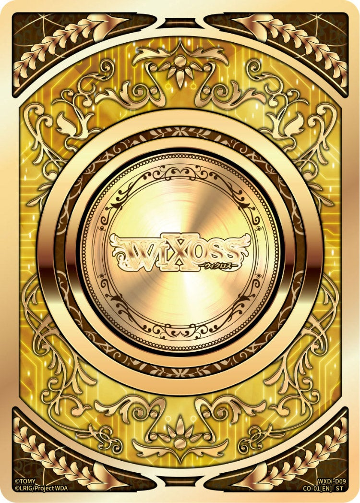

# Coin Card WXDi-D09-CO-01

## Thông tin lá

| Trường | Giá trị |
| --- | --- |
| Mã in | WXDi-D09-CO-01[EN] |
| Set | WXDi-D09[EN] |
| Loại thẻ | TOKEN |
| Vị trí | Ngoài deck (coin card) |
| Deck | Coin card |
| Số bản D09 | 2 |
| Màu | — |
| Độ hiếm | TK,TK(P) |
| Minh họa | — |
| Level | — |
| Limit | — |
| Power | 0 |
| LRIG type / Class | — |
| Team / Master | — |
| Cost | — |
| Grow cost | — |
| Use timing | — |
| Life Burst | Không |

## Card text chính thức

—

## Power text / Life Burst

—

## Ghi chú minh họa
Artist: —. Ảnh TK được tải từ Card List tiếng Anh.

Card List không trả tên cho mã này; đây là coin card đi kèm hộp D09, không thuộc 104 lá của hai deck.

## FAQ chính thức

— (không có FAQ riêng cho mã này trên trang FAQ tiếng Anh.)

## Ảnh biến thể

- [TK](../images/WXDi-D09-CO-01P-EN.jpg)

## Nguồn
[Card List/FAQ chính thức](https://www.takaratomy.co.jp/products/en.wixoss/card/card.html?card_no=WXDi-D09-CO-01%5BEN%5D ) · [Ảnh thẻ](https://www.takaratomy.co.jp/products/en.wixoss/card/thumb/WXDi-D09-CO-01%5BEN%5D.jpg)
