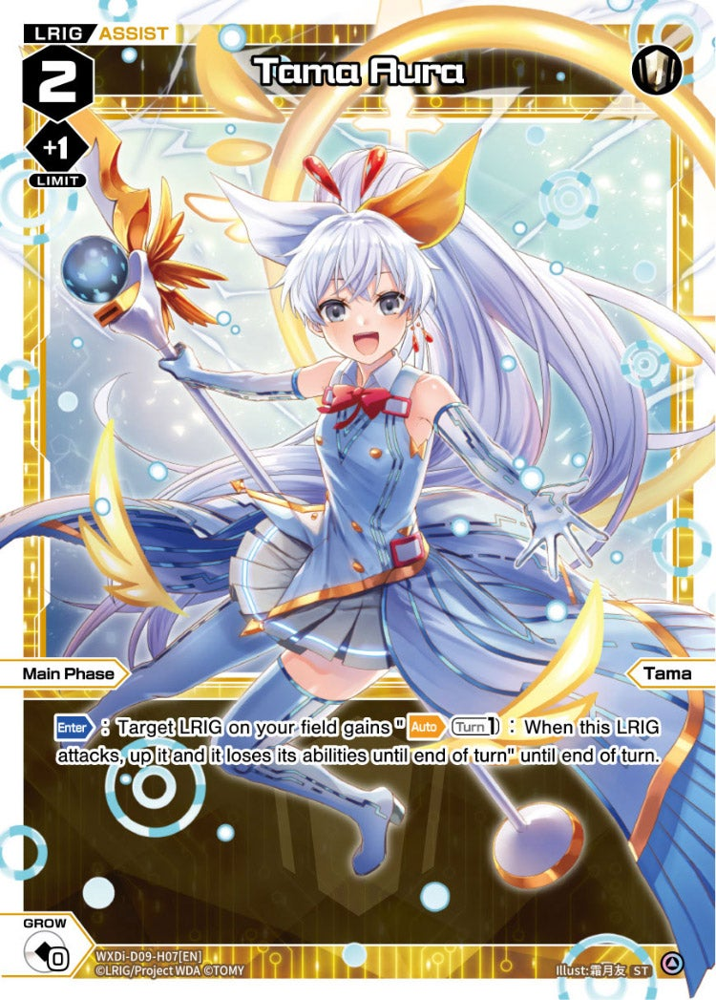

# Tama Aura

## Thông tin lá

| Trường | Giá trị |
| --- | --- |
| Mã in | WXDi-D09-H07[EN] |
| Set | WXDi-D09[EN] |
| Loại thẻ | ASSIST LRIG |
| Vị trí | LRIG Deck |
| Deck | Hirana |
| Số bản D09 | 1 |
| Màu | Trắng |
| Độ hiếm | ST |
| Minh họa | 霜月友 |
| Level | 2 |
| Limit | ＋１ |
| Power | 0 |
| LRIG type / Class | Tama |
| Team / Master | — |
| Cost | — |
| Grow cost | 《C》×０ |
| Use timing | Main Phase |
| Life Burst | Không |

## Card text chính thức

[Enter]: Target LRIG on your field gains "[Auto] {1/Turn}: When this LRIG attacks, up it and it loses its abilities until end of turn" until end of turn.

## Power text / Life Burst

—

## Ghi chú minh họa
Artist: 霜月友. Ảnh ST được tải từ Card List tiếng Anh.

## FAQ chính thức

— (không có FAQ riêng cho mã này trên trang FAQ tiếng Anh.)

## Nguồn
[Card List/FAQ chính thức](https://www.takaratomy.co.jp/products/en.wixoss/card/card.html?card_no=WXDi-D09-H07%5BEN%5D ) · [Ảnh thẻ](https://www.takaratomy.co.jp/products/en.wixoss/card/thumb/WXDi-D09-H07%5BEN%5D.jpg)
