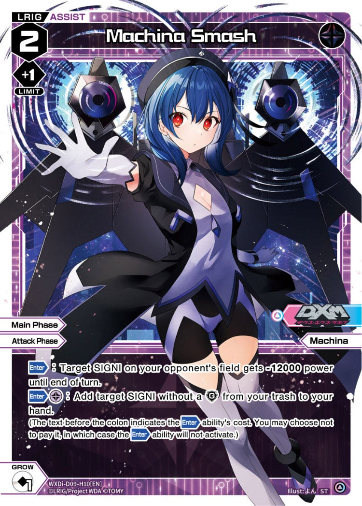

# Machina Smash

## Thông tin lá

| Trường | Giá trị |
| --- | --- |
| Mã in | WXDi-D09-H10[EN] |
| Set | WXDi-D09[EN] |
| Loại thẻ | ASSIST LRIG |
| Vị trí | LRIG Deck |
| Deck | Hirana |
| Số bản D09 | 1 |
| Màu | Đen |
| Độ hiếm | ST |
| Minh họa | よん |
| Level | 2 |
| Limit | ＋1 |
| Power | 0 |
| LRIG type / Class | Machina |
| Team / Master | DEUS・EX・MACHINA |
| Cost | — |
| Grow cost | 《C》×１ |
| Use timing | Main Phase
Attack Phase |
| Life Burst | Không |

## Card text chính thức

[Enter]: Target SIGNI on your opponent's field gets -12000 power until end of turn.
[Enter] {Black}: Add target SIGNI without a {Guard Icon} from your trash to your hand.
(The text before the colon indicates the [Enter] ability's cost. You may choose not to pay it, in which case the [Enter] ability will not activate.)

## Power text / Life Burst

—

## Ghi chú minh họa
Artist: よん. Ảnh ST được tải từ Card List tiếng Anh.

## FAQ chính thức

— (không có FAQ riêng cho mã này trên trang FAQ tiếng Anh.)

## Nguồn
[Card List/FAQ chính thức](https://www.takaratomy.co.jp/products/en.wixoss/card/card.html?card_no=WXDi-D09-H10%5BEN%5D ) · [Ảnh thẻ](https://www.takaratomy.co.jp/products/en.wixoss/card/thumb/WXDi-D09-H10%5BEN%5D.jpg)
