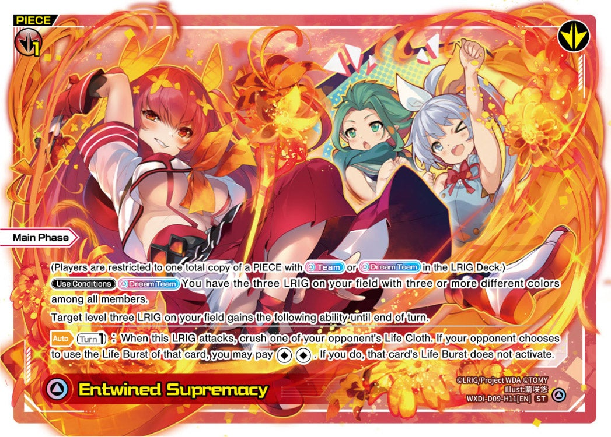

# Entwined Supremacy

## Thông tin lá

| Trường | Giá trị |
| --- | --- |
| Mã in | WXDi-D09-H11[EN] |
| Set | WXDi-D09[EN] |
| Loại thẻ | PIECE |
| Vị trí | LRIG Deck |
| Deck | Hirana |
| Số bản D09 | 1 |
| Màu | Đỏ |
| Độ hiếm | ST |
| Minh họa | 繭咲悠 |
| Level | — |
| Limit | — |
| Power | 0 |
| LRIG type / Class | — |
| Team / Master | — |
| Cost | 《R》×１ |
| Grow cost | — |
| Use timing | Main Phase |
| Life Burst | Không |

## Card text chính thức

(Players are restricted to one total copy of a PIECE with [Team] or [Dream Team] in the LRIG Deck.)
[Use Conditions] [Dream Team] You have the three LRIG on your field with three or more different colors among all members.

Target level three LRIG on your field gains the following ability until end of turn.
『[Auto] {1/Turn}: When this LRIG attacks, crush one of your opponent's Life Cloth. If your opponent chooses to use the Life Burst of that card, you may pay {Colorless} {Colorless}. If you do, that card's Life Burst does not activate.』

## Power text / Life Burst

—

## Ghi chú minh họa
Artist: 繭咲悠. Ảnh ST được tải từ Card List tiếng Anh.

## FAQ chính thức

— (không có FAQ riêng cho mã này trên trang FAQ tiếng Anh.)

## Nguồn
[Card List/FAQ chính thức](https://www.takaratomy.co.jp/products/en.wixoss/card/card.html?card_no=WXDi-D09-H11%5BEN%5D ) · [Ảnh thẻ](https://www.takaratomy.co.jp/products/en.wixoss/card/thumb/WXDi-D09-H11%5BEN%5D.jpg)
