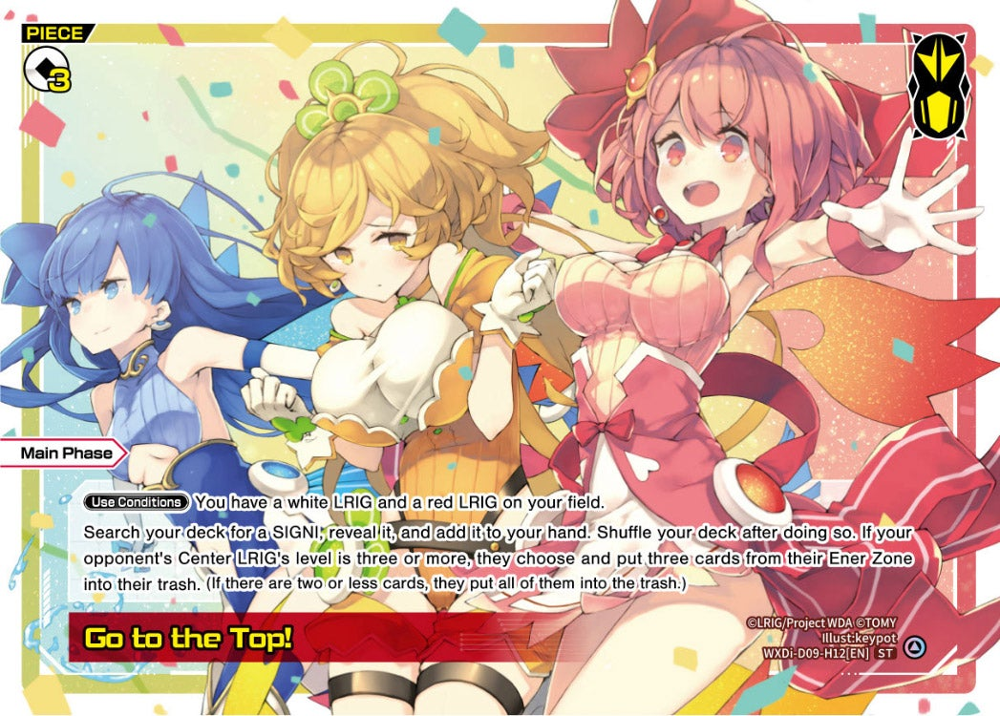

# Go to the Top!

## Thông tin lá

| Trường | Giá trị |
| --- | --- |
| Mã in | WXDi-D09-H12[EN] |
| Set | WXDi-D09[EN] |
| Loại thẻ | PIECE |
| Vị trí | LRIG Deck |
| Deck | Hirana |
| Số bản D09 | 1 |
| Màu | Đỏ / trắng |
| Độ hiếm | ST |
| Minh họa | keypot |
| Level | — |
| Limit | — |
| Power | 0 |
| LRIG type / Class | — |
| Team / Master | — |
| Cost | 《C》×３ |
| Grow cost | — |
| Use timing | Main Phase |
| Life Burst | Không |

## Card text chính thức

[Use Conditions] You have a white LRIG and a red LRIG on your field.

Search your deck for a SIGNI, reveal it, and add it to your hand. Shuffle your deck after doing so. If your opponent's Center LRIG's level is three or more, they choose and put three cards from their Ener Zone into their trash. (If there are two or less cards, they put all of them into the trash.)

## Power text / Life Burst

—

## Ghi chú minh họa
Artist: keypot. Ảnh ST được tải từ Card List tiếng Anh.

## FAQ chính thức

— (không có FAQ riêng cho mã này trên trang FAQ tiếng Anh.)

## Nguồn
[Card List/FAQ chính thức](https://www.takaratomy.co.jp/products/en.wixoss/card/card.html?card_no=WXDi-D09-H12%5BEN%5D ) · [Ảnh thẻ](https://www.takaratomy.co.jp/products/en.wixoss/card/thumb/WXDi-D09-H12%5BEN%5D.jpg)
