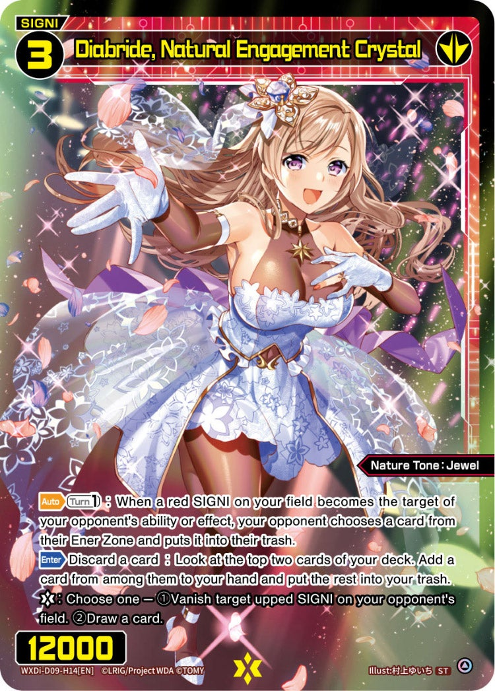

# Diabride, Natural Engagement Crystal

## Thông tin lá

| Trường | Giá trị |
| --- | --- |
| Mã in | WXDi-D09-H14[EN] |
| Set | WXDi-D09[EN] |
| Loại thẻ | SIGNI |
| Vị trí | Main Deck |
| Deck | Hirana |
| Số bản D09 | 1 |
| Màu | Đỏ |
| Độ hiếm | ST |
| Minh họa | 村上ゆいち |
| Level | 3 |
| Limit | — |
| Power | 12000 |
| LRIG type / Class | Nature Tone：Jewel |
| Team / Master | — |
| Cost | — |
| Grow cost | — |
| Use timing | — |
| Life Burst | Có |

## Card text chính thức

[Auto] {1/Turn}: When a red SIGNI on your field becomes the target of your opponent's ability or effect, your opponent chooses a card from their Ener Zone and puts it into their trash.
[Enter] Discard a card: Look at the top two cards of your deck. Add a card from among them to your hand and put the rest into your trash.

## Power text / Life Burst

Choose one — ①Vanish target upped SIGNI on your opponent's field. ②Draw a card.

## Ghi chú minh họa
Artist: 村上ゆいち. Ảnh ST được tải từ Card List tiếng Anh.

## FAQ chính thức

— (không có FAQ riêng cho mã này trên trang FAQ tiếng Anh.)

## Nguồn
[Card List/FAQ chính thức](https://www.takaratomy.co.jp/products/en.wixoss/card/card.html?card_no=WXDi-D09-H14%5BEN%5D ) · [Ảnh thẻ](https://www.takaratomy.co.jp/products/en.wixoss/card/thumb/WXDi-D09-H14%5BEN%5D.jpg)
