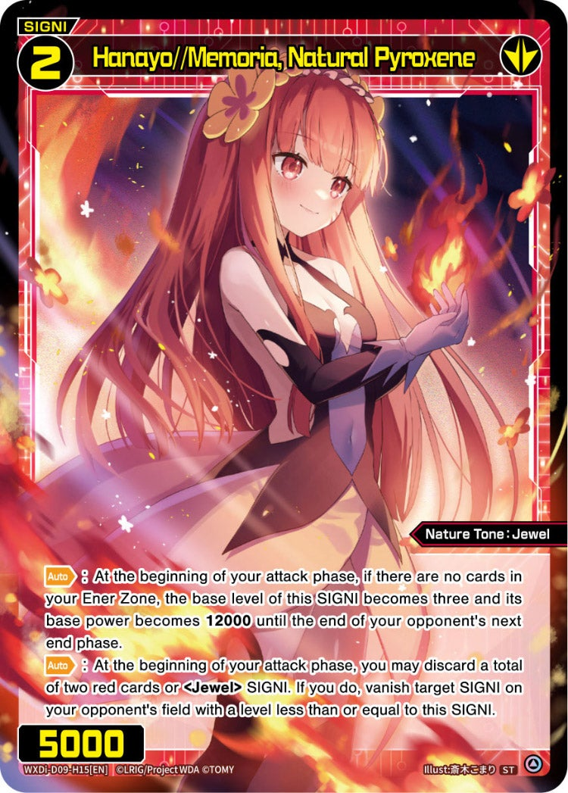

# Hanayo//Memoria, Natural Pyroxene

## Thông tin lá

| Trường | Giá trị |
| --- | --- |
| Mã in | WXDi-D09-H15[EN] |
| Set | WXDi-D09[EN] |
| Loại thẻ | SIGNI |
| Vị trí | Main Deck |
| Deck | Hirana |
| Số bản D09 | 2 |
| Màu | Đỏ |
| Độ hiếm | ST |
| Minh họa | 斎木こまり |
| Level | 2 |
| Limit | — |
| Power | 5000 |
| LRIG type / Class | Nature Tone：Jewel |
| Team / Master | — |
| Cost | — |
| Grow cost | — |
| Use timing | — |
| Life Burst | Không |

## Card text chính thức

[Auto]: At the beginning of your attack phase, if there are no cards in your Ener Zone, the base level of this SIGNI becomes three and its base power becomes 12000 until the end of your opponent's next end phase.
[Auto]: At the beginning of your attack phase, you may discard a total of two red cards or <Jewel> SIGNI. If you do, vanish target SIGNI on your opponent's field with a level less than or equal to this SIGNI.

## Power text / Life Burst

—

## Ghi chú minh họa
Artist: 斎木こまり. Ảnh ST được tải từ Card List tiếng Anh.

## FAQ chính thức

— (không có FAQ riêng cho mã này trên trang FAQ tiếng Anh.)

## Nguồn
[Card List/FAQ chính thức](https://www.takaratomy.co.jp/products/en.wixoss/card/card.html?card_no=WXDi-D09-H15%5BEN%5D ) · [Ảnh thẻ](https://www.takaratomy.co.jp/products/en.wixoss/card/thumb/WXDi-D09-H15%5BEN%5D.jpg)
