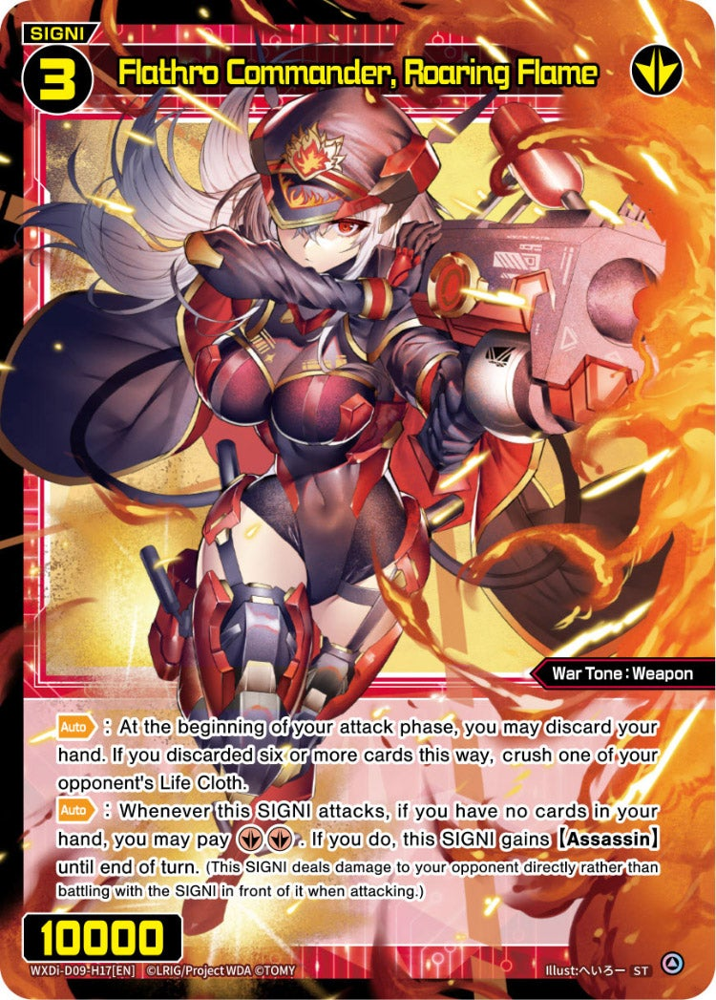

# Flathro Commander, Roaring Flame

## Thông tin lá

| Trường | Giá trị |
| --- | --- |
| Mã in | WXDi-D09-H17[EN] |
| Set | WXDi-D09[EN] |
| Loại thẻ | SIGNI |
| Vị trí | Main Deck |
| Deck | Hirana |
| Số bản D09 | 2 |
| Màu | Đỏ |
| Độ hiếm | ST |
| Minh họa | へいろー |
| Level | 3 |
| Limit | — |
| Power | 10000 |
| LRIG type / Class | War Tone：Weapon |
| Team / Master | — |
| Cost | — |
| Grow cost | — |
| Use timing | — |
| Life Burst | Không |

## Card text chính thức

[Auto]: At the beginning of your attack phase, you may discard your hand. If you discarded six or more cards this way, crush one of your opponent's Life Cloth.
[Auto]: Whenever this SIGNI attacks, if you have no cards in your hand, you may pay {Red} {Red}. If you do, this SIGNI gains 【Assassin】 until end of turn. (This SIGNI deals damage to your opponent directly rather than battling with the SIGNI in front of it when attacking.)

## Power text / Life Burst

—

## Ghi chú minh họa
Artist: へいろー. Ảnh ST được tải từ Card List tiếng Anh.

## FAQ chính thức

— (không có FAQ riêng cho mã này trên trang FAQ tiếng Anh.)

## Nguồn
[Card List/FAQ chính thức](https://www.takaratomy.co.jp/products/en.wixoss/card/card.html?card_no=WXDi-D09-H17%5BEN%5D ) · [Ảnh thẻ](https://www.takaratomy.co.jp/products/en.wixoss/card/thumb/WXDi-D09-H17%5BEN%5D.jpg)
