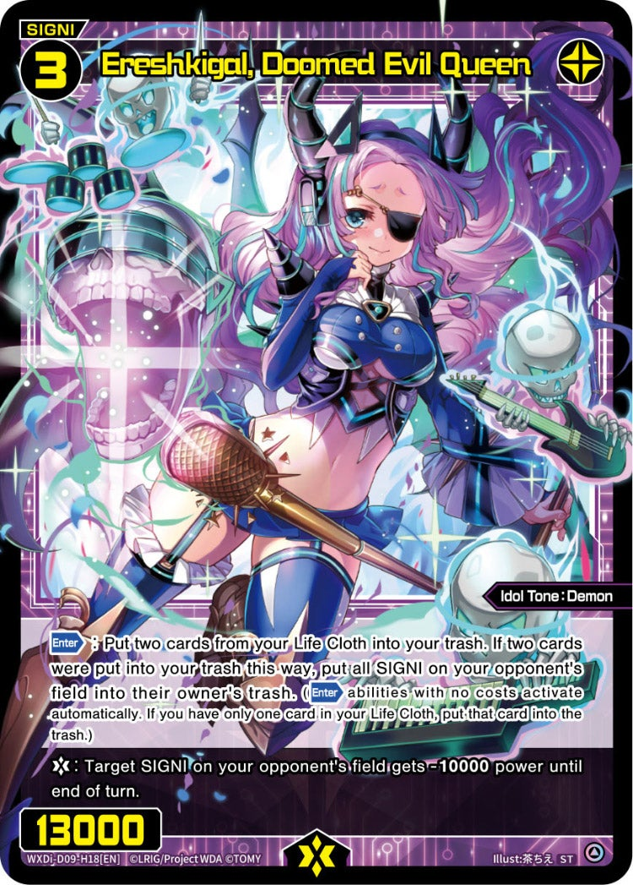

# Ereshkigal, Doomed Evil Queen

## Thông tin lá

| Trường | Giá trị |
| --- | --- |
| Mã in | WXDi-D09-H18[EN] |
| Set | WXDi-D09[EN] |
| Loại thẻ | SIGNI |
| Vị trí | Main Deck |
| Deck | Hirana |
| Số bản D09 | 1 |
| Màu | Đen |
| Độ hiếm | ST |
| Minh họa | 茶ちえ |
| Level | 3 |
| Limit | — |
| Power | 13000 |
| LRIG type / Class | Idol Tone：Demon |
| Team / Master | — |
| Cost | — |
| Grow cost | — |
| Use timing | — |
| Life Burst | Có |

## Card text chính thức

[Enter]: Put two cards from your Life Cloth into your trash. If two cards were put into your trash this way, put all SIGNI on your opponent's field into their owner's trash. ([Enter] abilities with no costs activate automatically. If you have only one card in your Life Cloth, put that card into the trash.)

## Power text / Life Burst

Target SIGNI on your opponent's field gets -10000 power until end of turn.

## Ghi chú minh họa
Artist: 茶ちえ. Ảnh ST được tải từ Card List tiếng Anh.

## FAQ chính thức

— (không có FAQ riêng cho mã này trên trang FAQ tiếng Anh.)

## Nguồn
[Card List/FAQ chính thức](https://www.takaratomy.co.jp/products/en.wixoss/card/card.html?card_no=WXDi-D09-H18%5BEN%5D ) · [Ảnh thẻ](https://www.takaratomy.co.jp/products/en.wixoss/card/thumb/WXDi-D09-H18%5BEN%5D.jpg)
