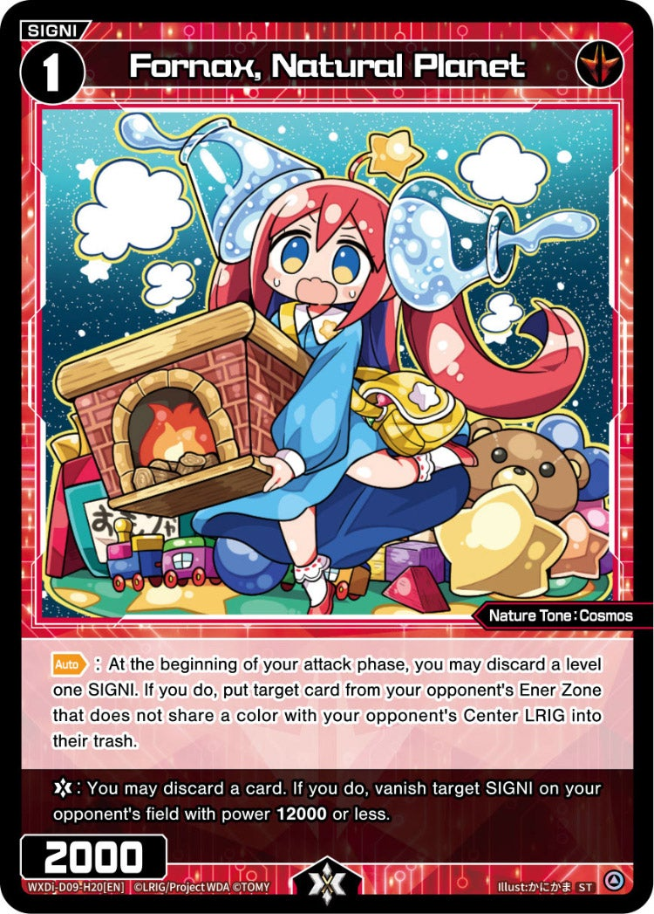

# Fornax, Natural Planet

## Thông tin lá

| Trường | Giá trị |
| --- | --- |
| Mã in | WXDi-D09-H20[EN] |
| Set | WXDi-D09[EN] |
| Loại thẻ | SIGNI |
| Vị trí | Main Deck |
| Deck | Hirana |
| Số bản D09 | 2 |
| Màu | Đỏ |
| Độ hiếm | ST |
| Minh họa | かにかま |
| Level | 1 |
| Limit | — |
| Power | 2000 |
| LRIG type / Class | Nature Tone：Cosmos |
| Team / Master | — |
| Cost | — |
| Grow cost | — |
| Use timing | — |
| Life Burst | Có |

## Card text chính thức

[Auto]: At the beginning of your attack phase, you may discard a level one SIGNI. If you do, put target card from your opponent's Ener Zone that does not share a color with your opponent's Center LRIG into their trash.

## Power text / Life Burst

You may discard a card. If you do, vanish target SIGNI on your opponent's field with power 12000 or less.

## Ghi chú minh họa
Artist: かにかま. Ảnh ST được tải từ Card List tiếng Anh.

## FAQ chính thức

— (không có FAQ riêng cho mã này trên trang FAQ tiếng Anh.)

## Nguồn
[Card List/FAQ chính thức](https://www.takaratomy.co.jp/products/en.wixoss/card/card.html?card_no=WXDi-D09-H20%5BEN%5D ) · [Ảnh thẻ](https://www.takaratomy.co.jp/products/en.wixoss/card/thumb/WXDi-D09-H20%5BEN%5D.jpg)
