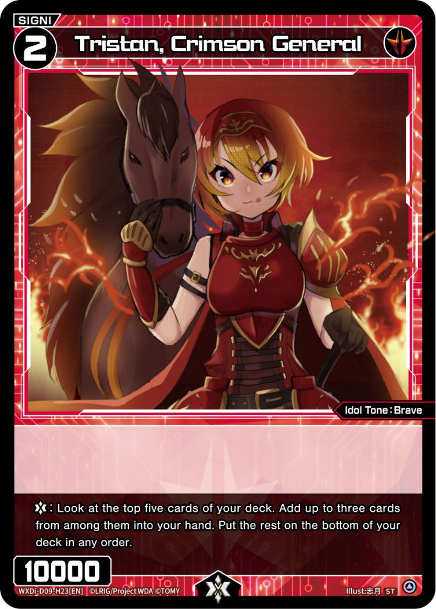

# Tristan, Crimson General

## Thông tin lá

| Trường | Giá trị |
| --- | --- |
| Mã in | WXDi-D09-H23[EN] |
| Set | WXDi-D09[EN] |
| Loại thẻ | SIGNI |
| Vị trí | Main Deck |
| Deck | Hirana |
| Số bản D09 | 2 |
| Màu | Đỏ |
| Độ hiếm | ST |
| Minh họa | 志月 |
| Level | 2 |
| Limit | — |
| Power | 10000 |
| LRIG type / Class | Idol Tone：Brave |
| Team / Master | — |
| Cost | — |
| Grow cost | — |
| Use timing | — |
| Life Burst | Có |

## Card text chính thức

—

## Power text / Life Burst

Look at the top five cards of your deck. Add up to three cards from among them into your hand. Put the rest on the bottom of your deck in any order.

## Ghi chú minh họa
Artist: 志月. Ảnh ST được tải từ Card List tiếng Anh.

## FAQ chính thức

— (không có FAQ riêng cho mã này trên trang FAQ tiếng Anh.)

## Nguồn
[Card List/FAQ chính thức](https://www.takaratomy.co.jp/products/en.wixoss/card/card.html?card_no=WXDi-D09-H23%5BEN%5D ) · [Ảnh thẻ](https://www.takaratomy.co.jp/products/en.wixoss/card/thumb/WXDi-D09-H23%5BEN%5D.jpg)
