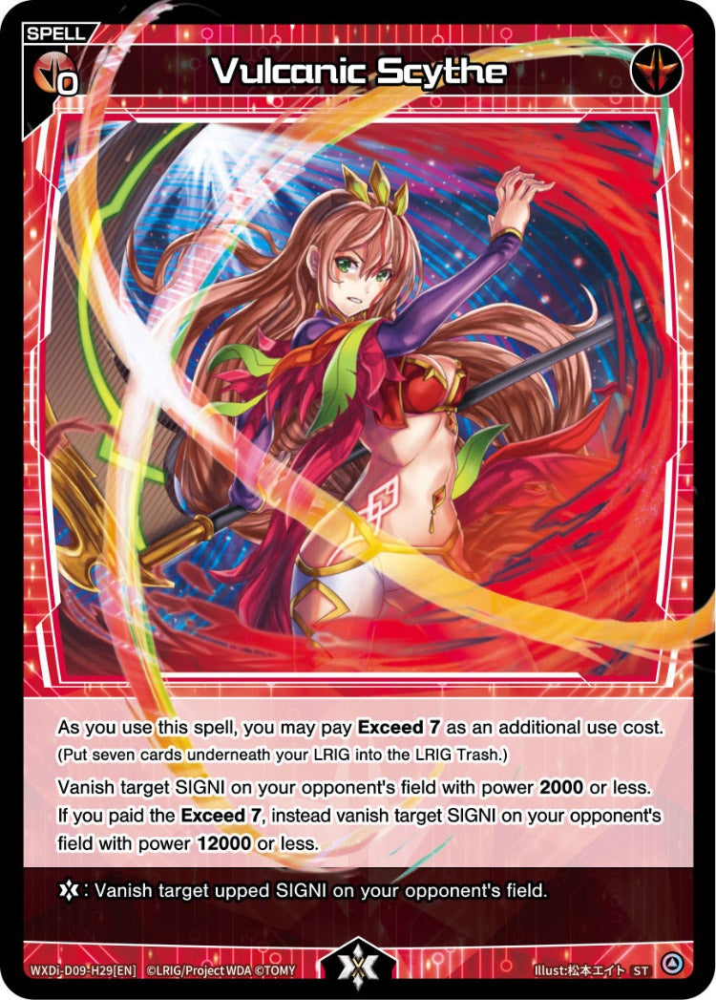

# Vulcanic Scythe

## Thông tin lá

| Trường | Giá trị |
| --- | --- |
| Mã in | WXDi-D09-H29[EN] |
| Set | WXDi-D09[EN] |
| Loại thẻ | SPELL |
| Vị trí | Main Deck |
| Deck | Hirana |
| Số bản D09 | 2 |
| Màu | Đỏ |
| Độ hiếm | ST |
| Minh họa | 松本エイト |
| Level | — |
| Limit | — |
| Power | 0 |
| LRIG type / Class | — |
| Team / Master | — |
| Cost | 《R》×０ |
| Grow cost | — |
| Use timing | — |
| Life Burst | Có |

## Card text chính thức

As you use this spell, you may pay Exceed 7 as an additional use cost. (Put seven cards underneath your LRIG into the LRIG Trash.)

Vanish target SIGNI on your opponent's field with power 2000 or less. If you paid the Exceed 7, instead vanish target SIGNI on your opponent's field with power 12000 or less.

## Power text / Life Burst

Vanish target upped SIGNI on your opponent's field.

## Ghi chú minh họa
Artist: 松本エイト. Ảnh ST được tải từ Card List tiếng Anh.

## FAQ chính thức

— (không có FAQ riêng cho mã này trên trang FAQ tiếng Anh.)

## Nguồn
[Card List/FAQ chính thức](https://www.takaratomy.co.jp/products/en.wixoss/card/card.html?card_no=WXDi-D09-H29%5BEN%5D ) · [Ảnh thẻ](https://www.takaratomy.co.jp/products/en.wixoss/card/thumb/WXDi-D09-H29%5BEN%5D.jpg)
