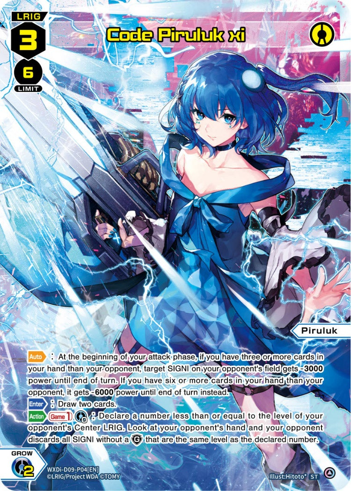

# Code Piruluk xi

## Thông tin lá

| Trường | Giá trị |
| --- | --- |
| Mã in | WXDi-D09-P04[EN] |
| Set | WXDi-D09[EN] |
| Loại thẻ | LRIG |
| Vị trí | LRIG Deck |
| Deck | Piruluk |
| Số bản D09 | 1 |
| Màu | Xanh dương |
| Độ hiếm | ST |
| Minh họa | Hitoto* |
| Level | 3 |
| Limit | 6 |
| Power | 0 |
| LRIG type / Class | Piruluk |
| Team / Master | — |
| Cost | — |
| Grow cost | 《U》×２ |
| Use timing | — |
| Life Burst | Không |

## Card text chính thức

[Auto]: At the beginning of your attack phase, if you have three or more cards in your hand than your opponent, target SIGNI on your opponent's field gets -3000 power until end of turn. If you have six or more cards in your hand than your opponent, it gets -6000 power until end of turn instead.
[Enter]: Draw two cards.
[Action] {1/Game} {Bluex0}: Declare a number less than or equal to the level of your opponent's Center LRIG. Look at your opponent's hand and your opponent discards all SIGNI without a {Guard Icon} that are the same level as the declared number.

## Power text / Life Burst

—

## Ghi chú minh họa
Artist: Hitoto*. Ảnh ST được tải từ Card List tiếng Anh.

## FAQ chính thức

— (không có FAQ riêng cho mã này trên trang FAQ tiếng Anh.)

## Nguồn
[Card List/FAQ chính thức](https://www.takaratomy.co.jp/products/en.wixoss/card/card.html?card_no=WXDi-D09-P04%5BEN%5D ) · [Ảnh thẻ](https://www.takaratomy.co.jp/products/en.wixoss/card/thumb/WXDi-D09-P04%5BEN%5D.jpg)
