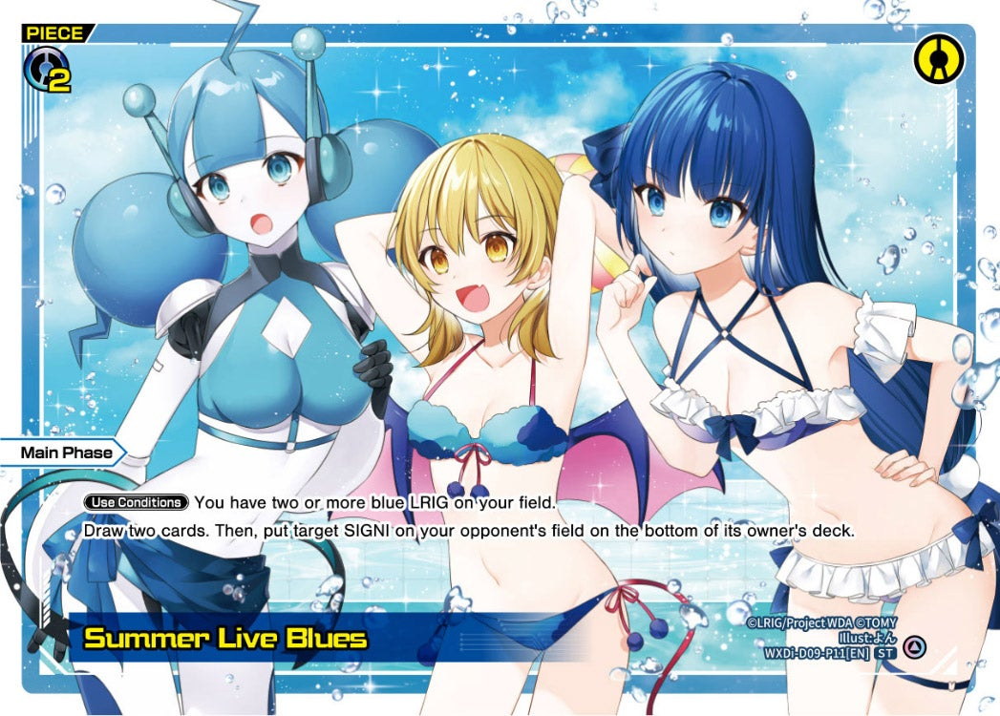

# Summer Live Blues

## Thông tin lá

| Trường | Giá trị |
| --- | --- |
| Mã in | WXDi-D09-P11[EN] |
| Set | WXDi-D09[EN] |
| Loại thẻ | PIECE |
| Vị trí | LRIG Deck |
| Deck | Piruluk |
| Số bản D09 | 1 |
| Màu | Xanh dương |
| Độ hiếm | ST |
| Minh họa | よん |
| Level | — |
| Limit | — |
| Power | 0 |
| LRIG type / Class | — |
| Team / Master | — |
| Cost | 《U》×２ |
| Grow cost | — |
| Use timing | Main Phase |
| Life Burst | Không |

## Card text chính thức

[Use Conditions] You have two or more blue LRIG on your field.

Draw two cards. Then, put target SIGNI on your opponent's field on the bottom of its owner's deck.

## Power text / Life Burst

—

## Ghi chú minh họa
Artist: よん. Ảnh ST được tải từ Card List tiếng Anh.

## FAQ chính thức

— (không có FAQ riêng cho mã này trên trang FAQ tiếng Anh.)

## Nguồn
[Card List/FAQ chính thức](https://www.takaratomy.co.jp/products/en.wixoss/card/card.html?card_no=WXDi-D09-P11%5BEN%5D ) · [Ảnh thẻ](https://www.takaratomy.co.jp/products/en.wixoss/card/thumb/WXDi-D09-P11%5BEN%5D.jpg)
