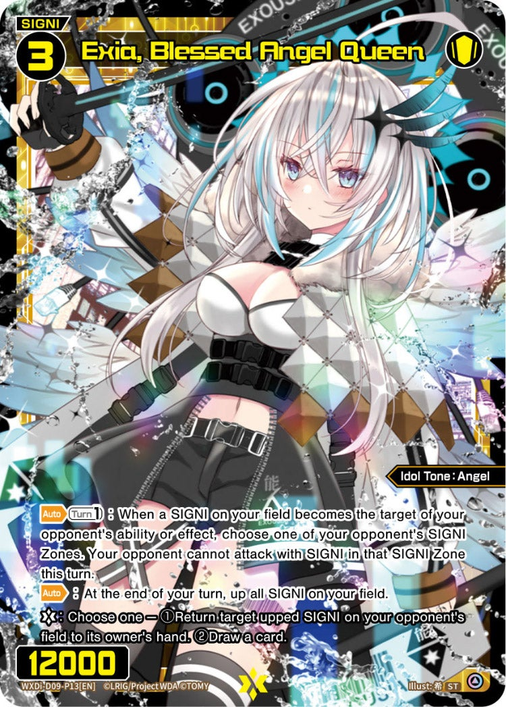

# Exia, Blessed Angel Queen

## Thông tin lá

| Trường | Giá trị |
| --- | --- |
| Mã in | WXDi-D09-P13[EN] |
| Set | WXDi-D09[EN] |
| Loại thẻ | SIGNI |
| Vị trí | Main Deck |
| Deck | Piruluk |
| Số bản D09 | 1 |
| Màu | Trắng |
| Độ hiếm | ST |
| Minh họa | 希 |
| Level | 3 |
| Limit | — |
| Power | 12000 |
| LRIG type / Class | Idol Tone：Angel |
| Team / Master | — |
| Cost | — |
| Grow cost | — |
| Use timing | — |
| Life Burst | Có |

## Card text chính thức

[Auto] {1/Turn}: When a SIGNI on your field becomes the target of your opponent's ability or effect, choose one of your opponent's SIGNI Zones. Your opponent cannot attack with SIGNI in that SIGNI Zone this turn.
[Auto]: At the end of your turn, up all SIGNI on your field.

## Power text / Life Burst

Choose one — ①Return target upped SIGNI on your opponent's field to its owner's hand. ②Draw a card.

## Ghi chú minh họa
Artist: 希. Ảnh ST được tải từ Card List tiếng Anh.

## FAQ chính thức

— (không có FAQ riêng cho mã này trên trang FAQ tiếng Anh.)

## Nguồn
[Card List/FAQ chính thức](https://www.takaratomy.co.jp/products/en.wixoss/card/card.html?card_no=WXDi-D09-P13%5BEN%5D ) · [Ảnh thẻ](https://www.takaratomy.co.jp/products/en.wixoss/card/thumb/WXDi-D09-P13%5BEN%5D.jpg)
