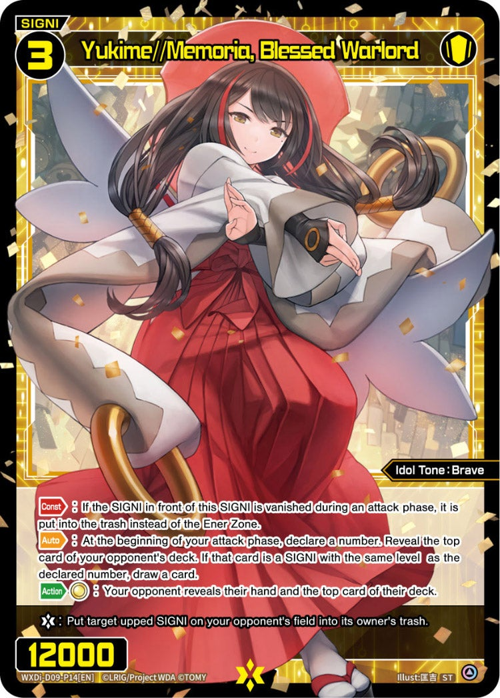

# Yukime//Memoria, Blessed Warlord

## Thông tin lá

| Trường | Giá trị |
| --- | --- |
| Mã in | WXDi-D09-P14[EN] |
| Set | WXDi-D09[EN] |
| Loại thẻ | SIGNI |
| Vị trí | Main Deck |
| Deck | Piruluk |
| Số bản D09 | 2 |
| Màu | Trắng |
| Độ hiếm | ST |
| Minh họa | 匡吉 |
| Level | 3 |
| Limit | — |
| Power | 12000 |
| LRIG type / Class | Idol Tone：Brave |
| Team / Master | — |
| Cost | — |
| Grow cost | — |
| Use timing | — |
| Life Burst | Có |

## Card text chính thức

[Constant]: If the SIGNI in front of this SIGNI is vanished during an attack phase, it is put into the trash instead of the Ener Zone.
[Auto]: At the beginning of your attack phase, declare a number. Reveal the top card of your opponent's deck. If that card is a SIGNI with the same level as the declared number, draw a card.
[Action] {Coin Icon}: Your opponent reveals their hand and the top card of their deck.

## Power text / Life Burst

Put target upped SIGNI on your opponent's field into its owner's trash.

## Ghi chú minh họa
Artist: 匡吉. Ảnh ST được tải từ Card List tiếng Anh.

## FAQ chính thức

— (không có FAQ riêng cho mã này trên trang FAQ tiếng Anh.)

## Nguồn
[Card List/FAQ chính thức](https://www.takaratomy.co.jp/products/en.wixoss/card/card.html?card_no=WXDi-D09-P14%5BEN%5D ) · [Ảnh thẻ](https://www.takaratomy.co.jp/products/en.wixoss/card/thumb/WXDi-D09-P14%5BEN%5D.jpg)
