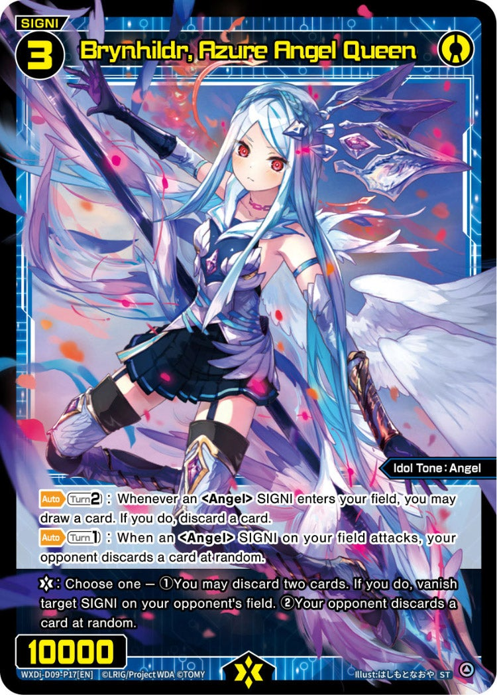

# Brynhildr, Azure Angel Queen

## Thông tin lá

| Trường | Giá trị |
| --- | --- |
| Mã in | WXDi-D09-P17[EN] |
| Set | WXDi-D09[EN] |
| Loại thẻ | SIGNI |
| Vị trí | Main Deck |
| Deck | Piruluk |
| Số bản D09 | 1 |
| Màu | Xanh dương |
| Độ hiếm | ST |
| Minh họa | はしもとなおや |
| Level | 3 |
| Limit | — |
| Power | 10000 |
| LRIG type / Class | Idol Tone：Angel |
| Team / Master | — |
| Cost | — |
| Grow cost | — |
| Use timing | — |
| Life Burst | Có |

## Card text chính thức

[Auto] {2/Turn}: Whenever an <Angel> SIGNI enters your field, you may draw a card. If you do, discard a card.
[Auto] {1/Turn}: When an <Angel> SIGNI on your field attacks, your opponent discards a card at random.

## Power text / Life Burst

Choose one — ①You may discard two cards. If you do, vanish target SIGNI on your opponent's field. ②Your opponent discards a card at random.

## Ghi chú minh họa
Artist: はしもとなおや. Ảnh ST được tải từ Card List tiếng Anh.

## FAQ chính thức

— (không có FAQ riêng cho mã này trên trang FAQ tiếng Anh.)

## Nguồn
[Card List/FAQ chính thức](https://www.takaratomy.co.jp/products/en.wixoss/card/card.html?card_no=WXDi-D09-P17%5BEN%5D ) · [Ảnh thẻ](https://www.takaratomy.co.jp/products/en.wixoss/card/thumb/WXDi-D09-P17%5BEN%5D.jpg)
