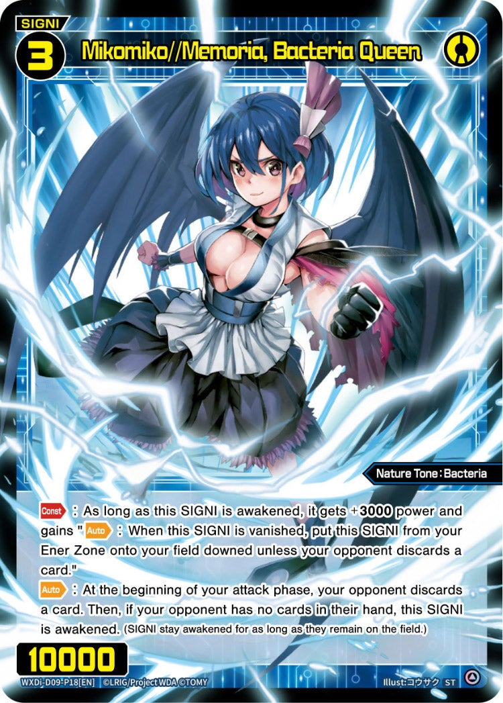

# Mikomiko//Memoria, Bacteria Queen

## Thông tin lá

| Trường | Giá trị |
| --- | --- |
| Mã in | WXDi-D09-P18[EN] |
| Set | WXDi-D09[EN] |
| Loại thẻ | SIGNI |
| Vị trí | Main Deck |
| Deck | Piruluk |
| Số bản D09 | 2 |
| Màu | Xanh dương |
| Độ hiếm | ST |
| Minh họa | コウサク |
| Level | 3 |
| Limit | — |
| Power | 10000 |
| LRIG type / Class | Nature Tone：Bacteria |
| Team / Master | — |
| Cost | — |
| Grow cost | — |
| Use timing | — |
| Life Burst | Không |

## Card text chính thức

[Constant]: As long as this SIGNI is awakened, it gets +3000 power and gains "[Auto]: When this SIGNI is vanished, put this SIGNI from your Ener Zone onto your field downed unless your opponent discards a card."
[Auto]: At the beginning of your attack phase, your opponent discards a card. Then, if your opponent has no cards in their hand, this SIGNI is awakened. (SIGNI stay awakened for as long as they remain on the field.)

## Power text / Life Burst

—

## Ghi chú minh họa
Artist: コウサク. Ảnh ST được tải từ Card List tiếng Anh.

## FAQ chính thức

— (không có FAQ riêng cho mã này trên trang FAQ tiếng Anh.)

## Nguồn
[Card List/FAQ chính thức](https://www.takaratomy.co.jp/products/en.wixoss/card/card.html?card_no=WXDi-D09-P18%5BEN%5D ) · [Ảnh thẻ](https://www.takaratomy.co.jp/products/en.wixoss/card/thumb/WXDi-D09-P18%5BEN%5D.jpg)
